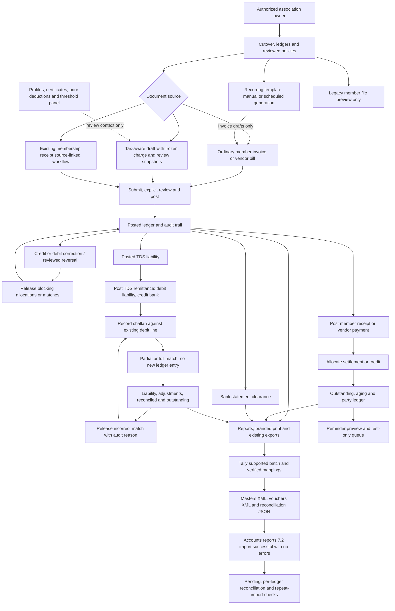

# FILMUNITY finance workflow — reviewed implementation blueprint

Prepared 21 November 2026 (Asia/Calcutta).

This document consolidates the finance workflow reviewed in this conversation and the current source. No separate verbatim blueprint or Mermaid chart was present in the available chat. It records current behavior and the user's Accounts report; it does not authorize deployment, live imports, migrations or the legacy membership write phase.

## Ownership and source records

FILMUNITY remains a Laravel/PostgreSQL modular application with React, TypeScript and Inertia, retaining the olive-green interface. The approved association registration applicant manages that association's finance workspace. Tenant context, record access and evidence downloads are checked on the server. A platform reviewer is not automatically an association finance owner.

Posted vouchers, tax snapshots and original document references are retained. Corrections, reversals, allocations, releases and review decisions are auditable records. Draft creation, posting and settlement are distinct actions.

## Operating sequence

1. Agree the books cutover date and verified opening balances. Initialize finance once. Set up ledgers, account groups, member/vendor party ledgers and the reviewed membership receipt policy. Native opening vouchers use the books start date; opening balances are excluded from this first Tally exporter.
2. Create an ordinary member invoice/vendor bill in **Invoices and settlements**, or use **GST / TDS billing** for tax-aware, tax-exclusive charge lines. Save a draft, inspect its lines/snapshots, **Submit for review**, then **Review and post** with an explicit decision and confirmation.
3. Record and post a receipt/payment separately, then **Apply settlement / credit** to the compatible invoice/bill for the same party. A remaining unallocated receipt/payment is an advance. Allocation changes bill tracking, not ledger postings.
4. Verify current outstanding and allocation history in billing Details, aging and the party ledger. Compare cash/bank statements in Ledger and save clearance with a statement reference. Clearance does not change posted amounts.
5. Use **Credit and debit notes** for supported reductions to posted originals. Tax notes retain original charge references and explicitly reviewed TDS reductions or retention. A reviewed reversal creates an opposite posting; release blocking allocations/challan matches first. Do not rewrite posted data.
6. Review reports and export a stable date range. Keep private evidence separately. Close a reviewed period only after resolving pending work and reconciliations; there is no reopen UI.

## Synthetic member example

Post a ₹5,000.00 invoice for Meena Example and a ₹2,000.00 receipt against the same member ledger. Allocate ₹2,000.00 to that invoice.

- **Invoices and settlements → Outstanding / available:** ₹3,000.00.
- **Details → Settlement allocation history:** active allocation ₹2,000.00.
- **Party ledger:** debit ₹5,000.00, credit ₹2,000.00, net debit ₹3,000.00, assuming no other entries.

An ordinary finance invoice/payment does not activate membership or issue a native membership payment receipt. Already-accounted membership receipts use the supported source-linked reclassification flow rather than a duplicate cash receipt.

## Vendor tax review and challan sequence

Vendor TDS profiles are association-scoped and effective-dated. Record the signed-in reviewer, notes and supporting reference. Certificates include a reference, inclusive validity dates, reviewed rate and optional private evidence. At bill entry the server validates any selected certificate against vendor, association and book date. Used context is frozen with the document; later profile changes do not rewrite it.

Prior deduction history reads posted snapshots and reviewed corrections/reversals through the bill book date. Its default period begins on 1 April of the containing financial year. Challan payments appear separately from deductions. The optional accountant-reviewed threshold panel compares configured eligible posted totals plus the current draft contribution. Missing settings/history produce an unavailable comparison with reasons. Neither panel chooses a rate or deduction; bill review remains explicit.

Illustrative Stagecraft Example bill:

| Component | Amount |
|---|---:|
| Tax-exclusive charge | ₹1,000.00 |
| Illustrative GST 18%, split CGST/SGST | ₹90.00 + ₹90.00 |
| Gross | ₹1,180.00 |
| Explicitly reviewed TDS 10% of ₹1,000.00 | ₹100.00 |
| Vendor party payable | ₹1,080.00 |

Post a separate remittance: debit the existing TDS liability ₹100.00 and credit Bank ₹100.00. **Vendor TDS challan reconciliation** records its posted debit line, challan reference, equal payment date and equal amount. Matching ₹40.00 then ₹60.00 against the original bill reconciles ₹100.00 with zero outstanding TDS. Recording/matching creates no second accounting entry and does not settle the vendor payable.

Alternative correction case: a ₹200.00 pre-GST reduction reverses ₹18.00 CGST and ₹18.00 SGST. With a reviewed ₹20.00 TDS reduction, note party amount is ₹216.00 and the original TDS liability becomes ₹80.00. After releasing any blocking matches, only ₹80.00 can be matched; a ₹100.00 challan then has ₹20.00 unmatched. A zero TDS reduction instead retains the original deduction. Release an incorrect match with a reason; reverse an incorrect payment separately through the reviewed voucher flow.

Rates, thresholds, legal references and certificate treatment are illustrative/reviewed inputs, not statutory advice. Arithmetic uses exact paise.

## Outputs, recurring drafts and reminders

- Stored invoices, vendor bills and credit/debit notes expose branded **Open / Print** or **Print details**, then browser **Print / Save as PDF**. Membership receipts/cards keep their existing downloads and print layouts. Inspect saved PDFs for long tables, page breaks, branding, dimensions and QR readability.
- Monthly recurring templates snapshot generated drafts. One template/billing period is enforced transactionally with database uniqueness. Month-end anchors clamp without drifting. Active missed periods catch up within the per-run limit; resume skips scheduled dates before today. The daily Laravel command reuses manual generation, isolates failures and leaves invoices in draft. This cleanup does not enable a production scheduler.
- Invoice reminders preview posted outstanding invoices and use a worker that rechecks eligibility. Daily occurrence uniqueness and audited queued/sent/skipped/failed/uncertain states protect retries; uncertain delivery requires review. Live invoice reminder delivery and reminder scheduling remain disabled. Existing membership communications have their own configured delivery behavior.
- Legacy member migration remains XLS/XLSX/CSV preview-only, with template downloads, mapping and row-level review. It does not create members, advance numbering or write balances.

## TallyPrime 7.2 evidence and remaining checks

**Accounts reported a successful TallyPrime 7.2 import with no errors.** This is the Accounts report supplied in this conversation, not an independently witnessed import by this cleanup.

**Per-ledger reconciliation and repeat-import behavior remain pending unless separately evidenced.** A successful parse/import is not proof that every ledger movement matches or that repeating an import prevents duplicates.

The first XML exporter supports basic Receipt, Payment, Contra and Journal entries and supported-source reversals. It shows exclusions and unmapped ledgers and provides separate masters XML, vouchers XML and reconciliation JSON using a stable batch fingerprint. Opening balances, party/bill-wise and tax/source-linked unsupported records stay excluded as reported by the batch. Debits are negative XML amounts with ISDEEMEDPOSITIVE Yes; credits are positive with No.

In a separate test company, retain the import result and reconcile voucher counts, debit/credit totals and each target ledger movement to the paise against the same batch's reconciliation JSON. Establish repeat-import behavior independently in a disposable test company. Do not import into live books from these instructions. The export screen's older pending-validation text is outside this targeted Help Centre wording cleanup.

## Mermaid operating flow

## Help Centre references

- `/association-help/finance?topic=start`
- `/association-help/finance?topic=invoices-settlements`
- `/association-help/finance?topic=allocations`
- `/association-help/finance?topic=multi-line-billing`
- `/association-help/finance?topic=tds-challans`
- `/association-help/finance?topic=tally-export`
- `/association-help/members?topic=legacy-preview`

The full article/path inventory is `resources/help/workflow-inventory.json`. Article IDs remain stable.
