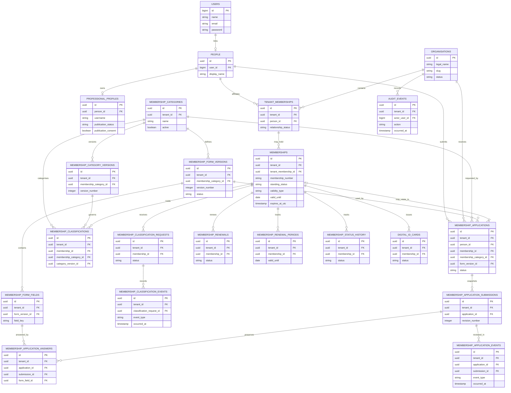
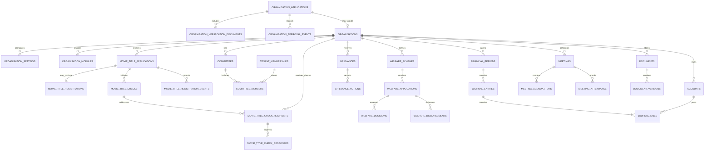

# FILMUNITY — Database Architecture

**Status:** Initial logical schema; not a production migration specification.  
**Database:** PostgreSQL

## TallyPrime 7.2 XML export prototype and test-company procedure (2026-11-21)

Target release supplied by the operator: TallyPrime 7.2. No XML exported from that release has been supplied yet; the supplied product-logo URL is not an XML accounting sample. Target-version sample validation and import rehearsal remain outstanding. The export screen labels this limitation. This is a TallyHelp-based basic accounting prototype, not a verified 7.2 import integration.

Official references: [TallyHelp XML examples](https://help.tallysolutions.com/sample-xml/), [debit/credit flag semantics](https://help.tallysolutions.com/article/DeveloperReference/faq/8855.html/), and [XML import procedure](https://help.tallysolutions.com/import-data-from-xml-or-json/). XMLWriter emits separate required-ledger masters and accounting vouchers. Debits use negative amounts/Yes; credits positive/No. Masters reference operator-verified built-in groups. There are no automatic ledger classifications or opening balances.

`association_tally_ledger_mappings` records explicit association/account target names, groups and verification actors. Composite foreign keys enforce tenant identity and case-normalized unique names prevent implicit ledger merging. Mapping changes are audited, without changing source accounts. The additive migration is `2026_11_21_100000_add_tally_ledger_mappings.php`, applied only to the verified isolated test database using `scripts/migrate-tally-mappings-test.php`.

The date-range preview includes basic Receipt, Payment, Contra and Journal entries; eligible original entries remain included after reversal and their reversal is a separate Journal movement. Reversals of unsupported entries are excluded. Opening, invoice, bill, credit/debit note, membership, source-linked, bill-wise, tax and party-ledger records are excluded with reasons. Drafts and rejected/submitted records are listed as not posted. Missing mappings block both XML downloads. Reconciliation JSON retains source UUIDs, voucher list, exclusions, mappings and ledger debit/credit/net movement, calculated using integer paise and BCMath. Masters and vouchers use stable source GUIDs; voucher reference contains association and voucher UUIDs. This does not guarantee repeat-import deduplication in an untested target release.

Posting and mapping changes share the association lock with batch preparation. Every download must supply the reviewed SHA-256 batch fingerprint; changes to the batch return HTTP 409. This prevents mixing masters/vouchers from different reviewed source states. Existing JSON/CSV exports remain unchanged.

### Manual procedure — separate TallyPrime 7.2 test company only

1. Create a separate disposable test company in TallyPrime 7.2 with INR as base currency and a financial period covering the synthetic batch. Confirm its name before every import. Do not select live association books.
2. In that test company, manually create a small balanced Receipt, Payment, Contra and Journal. Export those vouchers and their ledger masters as XML from 7.2. Provide the files for comparison of envelope, ledger-list tags, GUID behavior, numbering, amount signs and master groups. This comparison has not yet been performed.
3. In FILMUNITY, open Finance reports → TallyPrime XML export. Select dates, verify each exact target ledger name and built-in group, then refresh the batch. Review every excluded record and unmapped ledger. Opening balances are omitted; compare period movement, not cumulative balances.
4. Download masters XML, vouchers XML and reconciliation JSON for the same fingerprint. Retain all three together. Preserve the test-company backup before importing. Use distinct synthetic target ledger names or carefully verify existing masters; do not combine opening balances or overwrite live masters.
5. In the selected test company use Alt+O → Masters to import the masters file first, then Alt+O → Transactions for vouchers. These steps follow current TallyHelp; confirm the exact 7.2 screen/configuration against the installed release. Do not use an HTTP import endpoint or unattended live import.
6. Inspect import exceptions and Tally.imp. Check voucher types, dates, numbers, source references, debit/credit sides and per-ledger movements against reconciliation JSON. Counts and both totals must match to the paise. Verify reversal entries retain original references.
7. Only in the disposable test company, repeat the same import to determine the release's GUID/REMOTEID and numbering behavior. Record whether records are ignored, duplicated or altered. Do not assume repeat-import safety from stable IDs alone.
8. Record the version, sample filenames, import results and any differences. Until the sample comparison and reconciliation pass, treat all generated files as unvalidated for that target. No import into Tally has been performed by this change.

## Invoice reminder queue delivery and outcome review (2026-11-21)

Invoice reminders now enqueue `DeliverBillingInvoiceReminder` on the existing database connection, queue `billing-reminders`. Enqueue requires the database queue to share the application's database connection; the queued status, attempt token, job insertion and audit event commit atomically. The existing invoice/recipient/daily-occurrence uniqueness remains authoritative. Queue retries for queued/in-progress/completed occurrences do not create another send job. Dedicated test workers use `queue:work database --queue=billing-reminders --once --tries=1`; no production worker or reminder schedule is enabled.

The worker commits a sending claim before attempting delivery, then reacquires the association and occurrence locks and rechecks current invoice status, exact outstanding balance, member identity, verified address and occurrence date. Paid/reversed/stale/changed-recipient work is skipped. Token fencing plus terminal states make completed or superseded job replay a no-op. A confirmed non-delivery (`BillingReminderNotSent`) is failed and retryable. Other transport exceptions become uncertain. Worker failure after claim is uncertain; hard interruptions remaining in sending for over five minutes are surfaced as requiring review. No automatic resend is permitted for uncertain work.

Authorized reviewers must record a reason and either close without retry or confirm no message was accepted before allowing a new queued attempt. Resolution invalidates the old token and is audited. Statuses, attempts, reasons and append-only queue audit outcomes are visible in the association reminder screen; refresh reloads monitoring data. If completion persistence fails after a possible send, the committed claim/failure callback prevents an unreviewed second send.

Live delivery remains hard-disabled. Both the testing environment, explicit test switch and Laravel MailFake are required; otherwise the worker records skipped without invoking the mail transport. The sent status in this milestone means acceptance by the test fake only. Additive migration `2026_11_21_090000_add_invoice_reminder_queue.php` adds queue state/timestamps/token fields without rewriting old reminder/accounting history; guarded test script `scripts/migrate-billing-reminder-queue-test.php` applies only this migration to the verified isolated database.

## Billing invoice reminder preview and fake delivery (2026-11-21)

The association-owner-only billing reminder screen previews posted invoice balances using `filmunity_bill_amount` less active settlement allocations. Draft, submitted, rejected, reversed and zero-balance invoices are excluded; there is no separate void status in the existing voucher model. Unpaid and partially paid invoices qualify even before their due date; the preview explicitly labels not-yet-due, due-today and overdue reasons. Recipients are resolved from the invoice party ledger's association-scoped membership and current member account. Invalid/unverified addresses remain visible as blocked and cannot be requested.

`association_invoice_reminders` stores one occurrence per invoice, normalized recipient email and app-timezone calendar date, enforced by a database unique constraint. Request/dispatch serialize on the existing association lock, scope every lookup, and recheck owner authorization under that lock. Dispatch also locks the occurrence and rechecks invoice status, exact outstanding balance, member identity, verified recipient and occurrence date. Settlement, reversal, recipient changes or stale occurrences cancel pending work. Current amounts are snapshotted at fake dispatch. Successful simulated/cancelled occurrences are terminal; retry uses the existing record rather than generating another message. Attempts, timestamps and outcomes are recorded with append-only finance events, without changing ledger history.

Live sending is deliberately unavailable: `config/billing-reminders.php` defaults the test switch off, and dispatch requires both APP_ENV=testing and a Laravel MailFake even when that switch is enabled. Otherwise an attempt records `disabled` without calling mail. Fake exceptions record `failed` and can be retried; successful fake delivery records `simulated`, never `sent`. There is no reminder command or schedule registration. Production delivery and external exactly-once transport guarantees remain outside this milestone.

Additive migration: `2026_11_21_080000_add_billing_invoice_reminders.php`; guarded isolated migration script: `scripts/migrate-billing-reminders-test.php`.

## Scheduled recurring invoice draft generation (2026-11-21)

`filmunity:generate-recurring-invoices` processes templates across associations in bounded query chunks. Each template has its own transaction, retaining the existing association/template locks, immutable period snapshot and unique `(template_id,period)` constraint. The manual service accepts an optional template selector so scheduled processing reuses identical generation logic without allowing one template failure to roll back another template's work. The current approved association owner is resolved server-side and authorized on every scheduled attempt; the template's original creator is not granted permanent authority.

Generated/skipped outcomes are appended to the finance audit trail in the successful transaction. Failed attempts are recorded after rollback with zero drafts and a review reason; database exception details remain in server logs. If audit storage itself fails, the command logs/reports that failure and continues processing other templates. A nonzero command exit reports any failed templates. Failed templates retain their cursor and numbering and can be retried. Paused/not-due templates record skipped outcomes. Manual/scheduled overlap uses the same locks and unique period identity. Draft state, month-end clamping, due-date rules, 24-period per-template batch limit and resume skipping are unchanged.

`routes/console.php` registers the command daily at 01:00 in `config('app.timezone')` (currently UTC), with a 120-minute scheduler overlap mutex. Database protections also apply when commands are invoked directly or overlap manual actions. Registration is verified with `php artisan schedule:list`; no OS scheduler, production worker or cron is enabled by this change. No schema migration is needed. Reminder delivery and automatic posting remain outside scope. The template screen includes scheduled outcomes in recent activity.

## Recurring member invoice templates (2026-11-21)

`association_invoice_templates` stores an existing association member ledger, ordinary non-tax invoice line definitions, fixed monthly anchor/start date, next period cursor, due-after-calendar-days rule and pause state. Authorized association users create templates and edit future line/name/due values. Member and schedule identity remain fixed. Generation is manual; console routes currently define no scheduler for this workflow. Posting, collection, reminders and automatic scheduling remain outside this release.

`association_invoice_template_runs` records an immutable generation snapshot, source template, monthly period and invoice voucher. `UNIQUE(template_id,period)` and composite tenant foreign keys enforce identity and scoping. Generation acquires the existing association row lock and template locks, calls the ordinary invoice draft service, validates multi-line double entries through the existing finance service, and commits the draft, immutable snapshot and period cursor in one transaction. Overlapping requests serialize; rollback restores counters and cursor. A successful period is never regenerated even if its invoice is later rejected or reversed. Failed/closed-book validation rolls back the entire action.

Monthly dates clamp to the last calendar day without anchor drift (31 January → 28/29 February → 31 March). Due dates add 0–90 calendar days to each billing date. Active overdue templates catch up, limited to 24 periods per template per action. Paused templates generate nothing. Resume advances the cursor past scheduled dates strictly before the resume date; today's scheduled date remains eligible. Skipped periods are not backfilled. Pause/resume audit events retain old/new cursors; generation events record successful attempts including zero drafts. Template edits affect generation after the edit, including still-pending active catch-up periods, never existing drafts or run snapshots.

Generated lines remain available in the invoice print view and recent-run screen as values used at generation. Later manual edits to an ordinary draft remain subject to existing billing permissions; the generation snapshot remains unchanged. No tax automation is introduced. Additive migration: `2026_11_21_070000_add_recurring_member_invoices.php`; isolated guarded test runner: `scripts/migrate-recurring-invoices-test.php`.

## Read-only vendor threshold review (2026-11-21)

The immutable vendor review profile optionally records an accountant-reviewed threshold amount, explicit eligibility basis and aggregation period, plus accountant-review and history-completeness confirmations. No statutory amount or rule is supplied. The initial supported basis is all posted vendor-bill pre-GST charges (including exempt/non-GST), net of reviewed charge corrections and reversal movements, aggregated from 1 April through book date. The accountant must decide whether this supported basis is appropriate; alternative rules remain unconfigured/unavailable.

The authorized read-only `/tax/vendor-threshold` endpoint resolves the effective profile and scopes the vendor to its association. Frozen bill bases and correction charge amounts supply movement values; reversal vouchers offset amounts on their own dates. Drafts are excluded. Missing settings, confirmations or frozen source amounts disable comparison and return explicit reasons. Historical completeness confirmation requires reviewing opening records, advances and excluded transactions; the panel cannot infer unrecorded activity. Known subtotals remain labeled incomplete when comparison is unavailable.

The current unsaved bill contributes only its entered pre-GST charge total. Invalid draft amounts disable comparison. PostgreSQL numeric and BCMath preserve exact paise arithmetic. Below/equal/above describe arithmetic comparison only, and neither select a rate nor alter deductions or approval. Source links and reviewed settings appear in the bill form. The additive `2026_11_21_060000_add_vendor_tds_threshold_review.php` migration is applied to the isolated test database via `scripts/migrate-vendor-tds-threshold-test.php`; no reset is required.

## Vendor TDS certificate tracking (2026-11-21)

The immutable vendor TDS review profile optionally records a certificate reference and inclusive validity dates, using its existing reviewed rate and supporting reference. The additive `2026_11_21_050000_add_vendor_tds_certificates.php` migration adds these fields and a private evidence path. Existing upload restrictions and local private storage are reused; evidence downloads require association authorization and scoped profile lookup. Paths are excluded from client profile data and bill snapshots.

Bill entry displays absent, not-yet-valid, expired or valid-on-book-date status. Selecting a certificate is explicit and is cleared when vendor, book date or document type changes. The server validates profile ownership, vendor identity, review effective date and both validity endpoints. Its reference, validity, reviewed rate, reviewer and supporting reference are frozen in the existing tax snapshot and rendered by the print view. The bill rate remains an explicitly reviewed value and is not populated from the certificate. Later profile versions preserve earlier posted snapshots. No threshold calculations, automatic deductions or filing are added.

Use `scripts/migrate-vendor-tds-certificates-test.php` for the guarded additive test migration; no reset is required.

## Read-only vendor TDS history (2026-11-21)

The authorized `/association-finance/{association}/tax/vendor-history` read endpoint scopes the vendor server-side and limits the period end to the entered bill book date. The initial period starts on 1 April of that book date's financial year. History reads frozen vendor bill TDS values, reviewed correction snapshots and their posted reversal vouchers. Original movements remain in their original periods even after reversal; offset movements use the reversal book date. Drafts and submitted entries are excluded. Zero-TDS adjustments remain visible to distinguish reviewed retention from reversal. PostgreSQL numeric and BCMath preserve exact paise totals.

Challan payments appear separately, limited to active matches for the selected vendor and paid within the selected period. Whole challan amounts and vendor-matched shares are distinguished. Unmatched remittances cannot be attributed to a vendor; payment amounts never reduce deduction totals. The UI provides source links and does not modify bill values or approval. No new tables, postings, automatic threshold decisions or deductions are introduced.

## Vendor TDS review profiles (2026-11-21)

`association_vendor_tds_reviews` stores association/vendor-scoped, immutable review versions keyed by effective date. Each version records the authenticated reviewer, review notes, optional supporting reference, reviewed legal reference and rate. A composite vendor foreign key prevents foreign-association references; duplicate effective dates are rejected. New reviews append history rather than editing previous versions.

Bill entry displays the latest effective date on or before the book date. Using that context is optional and requires explicit selection plus the existing bill approval. The server reselects the effective review for the actual vendor and book date and rejects a stale or foreign profile ID. Its complete saved values are embedded in the existing frozen tax document JSON, alongside bill-specific reviewed bases, rate and calculated amounts. Profile rates do not populate bill rates or trigger deductions. Later and backdated review versions do not rewrite saved bills. Threshold automation and filing remain outside this workflow.

The additive migration is `2026_11_21_040000_add_vendor_tds_reviews.php`; the guarded test migration script is `scripts/migrate-vendor-tds-reviews-test.php`.

## Vendor TDS challan reconciliation (2026-11-21)

`association_tds_challans` links a challan reference, payment date and integer paise amount to one existing posted TDS payment debit line. The amount and date must match that line. The general finance payment debits TDS payable and credits cash/bank; challan recording never posts another entry. One challan per debit line and one reference per association prevent duplicate recording.

`association_tds_matches` allocates a challan to posted vendor-bill TDS credits in the same liability ledger. Available liability is the original credit less posted reviewed note debits and active matches. All mutations resolve association authorization and serialize on the existing association lock; amounts use integer paise. Request tokens are idempotent and reject changed payloads. Releases retain actor, time and reason; finance audit events retain source voucher and reconciliation IDs. Matching creates no ledger lines.

Release active matches before reversing the source bill/payment or posting an adjustment that reduces liability below the matched amount. A PostgreSQL voucher-status trigger enforces this alongside application checks. Reversing a reviewed note restores available liability through its existing ledger reversal. To correct a remittance, release matches and use the existing reviewed payment reversal flow; retain the old challan as history and link the replacement payment separately.

The additive migration is `2026_11_21_030000_add_tds_challan_reconciliation.php`. The guarded `scripts/migrate-tds-reconciliation-test.php` applies only that migration after verifying the isolated PostgreSQL test database and role. No reset is required. The existing v6 export format is unchanged; this milestone exposes reconciliation history through the authorized challan screen and finance audit trail.

## 1. Architecture scope and design rules

FILMUNITY uses PostgreSQL as its primary relational database.

The platform contains two distinct data domains:

1. **Global platform domain:** authentication, human identity, professional community profiles, public portfolios, discovery, and platform-level operations.
2. **Organisation domain:** association membership, administration, approvals, documents, governance, optional modules, and tenant-specific workflows.

Global professional profiles are not owned by an association. Organisation-owned records must remain isolated from other organisations.

### 1.1 Identifier strategy

1. Preserve the existing Laravel `users.id` BIGINT primary key.
2. Preserve the existing Laravel authentication system, including email verification, sessions, passkeys, and two-factor authentication.
3. Use UUID primary keys for new domain entities where appropriate.
4. Foreign keys referencing `users.id` must use BIGINT-compatible types.
5. Foreign keys referencing UUID entities must use UUID-compatible types.
6. Do not convert existing authentication primary keys solely for architectural consistency.
7. Use opaque public identifiers where internal identifiers should not be exposed.

### 1.2 Global identity

1. `users` represents authentication accounts.
2. `people` represents human identity independently of authentication.
3. A person may optionally link to one verified authentication account.
4. A person may have one global professional profile.
5. A person may have relationships with multiple organisations.
6. Association records must not automatically become public profile information.
7. Account claiming and identity linking require verification, consent, and authorisation.

### 1.3 Tenant isolation

1. Every organisation-owned table must carry a non-null `tenant_id`, except where a documented alternative ownership model is explicitly approved.
2. Global platform tables must not be assigned an artificial organisation tenant.
3. Enforce tenant isolation through server-side context, policies, query constraints, and database relationships.
4. Use tenant-aware unique constraints and composite foreign keys where appropriate.
5. Propagate tenant context safely into background jobs, notifications, exports, and scheduled tasks.
6. Prevent cross-tenant references and unauthorised access through automated negative tests.
7. PostgreSQL row-level security may provide additional protection after transaction and connection-pooling behaviour is verified.

### 1.4 Data integrity and privacy

1. Store timestamps in UTC using appropriate PostgreSQL timestamp types.
2. Store monetary values using exact numeric types or integer minor units, never floating point.
3. Use explicit lifecycle statuses and auditable history for important business operations.
4. Store private files in protected object storage; retain metadata and opaque storage keys in PostgreSQL.
5. Use soft deletion only when restoration is appropriate.
6. Preserve legally required or security-relevant audit evidence according to documented retention policies.
7. Do not use email addresses or mobile numbers as universal person identifiers without a verified identity policy.
8. Public professional profiles require explicit consent, publication eligibility, and moderation controls.
9. Preserve submitted membership-form schema versions and associated answers.
10. Never automatically approve membership or movie-title applications solely because a deadline expires.

### 1.5 Deployment boundaries

1. The centrally hosted FILMUNITY service supports multiple isolated organisations.
2. Self-hosted installations use separate databases, storage, secrets, and authentication infrastructure.
3. Central FILMUNITY accounts do not automatically authenticate into independent self-hosted deployments.
4. Future identity federation must be separately designed, secured, and explicitly authorised.
5. Apache-2.0 core software rights must remain distinct from separately licensed proprietary Pro services.

## 2. Core entity groups

The following entities define the proposed logical architecture. Except for existing Laravel authentication and infrastructure tables, these names do not imply that migrations or models have already been implemented.

### 2.1 Authentication and global identity

- `users`: existing Laravel authentication accounts with BIGINT primary keys.
- `people`: global human identity records with UUID primary keys and optional unique BIGINT `user_id` references.
- `identity_claims`: verified requests to link existing person records to authenticated accounts.
- `platform_roles`: platform-level role definitions.
- `platform_user_roles`: assignments of platform roles to authenticated users.
- `platform_audit_events`: platform-level security and administrative audit evidence.

Existing Laravel sessions, password-reset, passkey and two-factor authentication infrastructure must be preserved.

A person may have one linked authentication account and may participate in multiple organisations. Account claiming requires identity verification, authorisation and audit evidence.

### 2.2 Global professional community

- `professional_profiles`: one global professional profile per person, with a canonical unique username, publication status and visibility settings.
- `professional_categories`: controlled professional classifications.
- `professional_skills`: controlled skills and specialisations.
- `professional_profile_skills`: skills associated with professional profiles.
- `professional_experiences`: work history, biography details and professional experience.
- `professional_credits`: filmography and credited productions.
- `professional_profile_media`: portfolio images and associated media metadata.
- `professional_social_links`: validated professional and social-media links.
- `profile_completion_rules`: versioned rules for calculating profile completeness.
- `profile_publication_events`: publication, unpublication and moderation history.
- `professional_connections`: consent-aware professional connection relationships.
- `professional_reports`: reports of inappropriate or misleading public profile content.

Public profile routes use the canonical pattern `/community/@username`.

Usernames require case-insensitive uniqueness, canonicalisation and reserved-name protection. Publication requires 100% profile completeness under the applicable rules, explicit consent and moderation eligibility.

Profile completeness does not grant permission to publish private association records.

### 2.3 Organisation registry and onboarding

- `organisations`: approved association and union registry.
- `organisation_domains`: verified organisation domain mappings.
- `organisation_applications`: applications to register organisations on FILMUNITY.
- `organisation_verification_documents`: private documents submitted for organisation verification.
- `organisation_approval_events`: approval, rejection and review history.
- `organisation_settings`: organisation-specific configuration.
- `organisation_modules`: enabled optional modules and their configuration.

Organisation applications are platform-owned before an organisation tenant exists. Approval and tenant provisioning must be separate, auditable operations.

### 2.4 Association identity and access

- `tenant_memberships`: person-to-organisation affiliations, including pending and approved relationships.
- `roles`: organisation-scoped role definitions.
- `permissions`: defined organisation permissions.
- `role_permissions`: permission assignments to roles.
- `user_role_assignments`: organisation-scoped authenticated user role assignments.
- `audit_events`: tenant-owned security and business audit evidence.

Organisation roles never grant automatic access to another organisation. Platform-level roles are distinct from organisation-scoped roles.

### 2.5 Membership applications and dynamic forms

- `membership_categories`: association-owned classification catalog, with optional FILMUNITY templates and tenant-specific eligibility policies.
- `membership_form_versions`: immutable published versions of registration forms.
- `membership_form_fields`: field definitions, validation rules and presentation metadata associated with form versions.
- `membership_applications`: organisation-scoped applications referencing a person, membership category and submitted form version.
- `membership_application_answers`: submitted answers preserved against the applicable form version.
- `membership_application_events`: review, decision and status history.
- `memberships`: permanent formal association memberships, allocated only upon successful first activation, distinct from approved applications and pending activation cases.
- `membership_category_versions`: immutable eligibility-rule versions, evidence requirements and effective dates.
- `membership_classifications`: approved classifications attached to a persistent formal membership, referencing the approved eligibility-rule version.
- `membership_classification_requests`: authorised requests for classification additions, removals, changes and reassessment.
- `membership_classification_events`: immutable classification decision and change history.
- `membership_renewals`: renewal applications, approvals and decision evidence.
- `membership_renewal_periods`: immutable approved validity-period history.
- `membership_application_submissions`: immutable snapshots of initial submissions and corrected resubmissions, including document references.
- `membership_status_history`: membership lifecycle history.
- `membership_number_sequences`: organisation-specific membership number allocation.
- `member_documents`: private membership-related document metadata.
- `digital_id_cards`: digital membership credentials.
- `id_verification_events`: privacy-preserving credential verification history.

An application must not require an already approved membership. A person may apply to multiple organisations, subject to each organisation's rules.

Published form versions must remain available for historical interpretation of submitted answers. Changes to a registration form must not silently reinterpret earlier submissions.

### 2.6 Movie-title registration

- `movie_title_applications`: organisation-scoped applications for proposed movie titles.
- `movie_title_registrations`: approved registrations within the issuing producer association.
- `movie_title_checks`: requests sent to other participating producer associations.
- `movie_title_check_recipients`: recipient associations, notification status and applicable response deadlines.
- `movie_title_check_responses`: recipient replies, objections and supporting evidence.
- `movie_title_registration_events`: decisions, conflicts and audit history.

Movie-title registration is an optional module for eligible producer associations.

Title uniqueness is enforced within the issuing association using a documented title-normalisation policy. Inter-association checks do not create a universal title registry or guarantee legal exclusivity.

The default response period is 30 calendar days, configurable per association. Deadline expiry must never automatically approve a registration. Authorised staff must make and record the final decision.

Cross-association title-check communication is a narrowly authorised workflow. It must not expose unrelated private tenant records.

### 2.7 Governance and operations

- `committees`
- `office_bearer_terms`
- `committee_members`
- `meetings`
- `meeting_agenda_items`
- `meeting_attendance`
- `meeting_minutes`
- `resolutions`
- `notices`
- `notice_recipients`

### 2.8 Welfare and grievances

- `welfare_schemes`
- `welfare_applications`
- `welfare_decisions`
- `welfare_disbursements`
- `grievances`
- `grievance_assignments`
- `grievance_actions`
- `grievance_attachments`

Grievance records require additional confidentiality controls beyond ordinary tenant isolation.

### 2.9 Finance

- `financial_periods`
- `accounts`
- `journal_entries`
- `journal_lines`
- `payments`
- `receipts`
- `reconciliation_batches`

Financial records require tenant-scoped access controls, immutable posted journals and audited exports.

### 2.10 Documents and communications

- `documents`
- `document_versions`
- `document_access_grants`
- `communication_templates`
- `communication_delivery_events`
- `communication_preferences`

Document ownership, storage paths and download authorisation must reflect the applicable global or organisation data domain.

### 2.11 Self-hosted Pro entitlements

Pro deployment entitlements may be represented by:

- `deployment_licences`: proprietary service or module entitlements.
- `licence_activations`: authorised activation and verification history.

These records belong to an appropriately separated entitlement service or deployment-management domain, not automatically to an association's private membership database.

Licence enforcement must apply only to separately licensed proprietary functionality. Apache-2.0 core functionality must remain usable under its open-source licence.

## 3. ER diagram - core identity and membership foundation

The following diagram describes the proposed central FILMUNITY identity and membership architecture.



### 3.1 Identity constraints

- Preserve the existing BIGINT `users.id`.
- `people.user_id` is nullable and unique when populated.
- A person may have at most one global professional profile.
- Public usernames require canonicalisation and case-insensitive uniqueness.
- Global professional profiles must not expose private association information.

### 3.2 Membership constraints

- Applications reference a person and an organisation before membership approval.
- Submitted applications retain their published membership-form version.
- Membership records may reference the applications that produced them.
- Every membership belongs to an organisation-specific person affiliation.
- Cross-tenant references must be prevented using appropriate composite foreign keys.
- Each membership form version belongs to a category in the same tenant.
- Each application references a category and a published form version belonging to that category and tenant.
- Each submitted answer references a field belonging to the exact form version used by its application; enforce tenant and version consistency with database constraints where practical.
- A tenant affiliation is created or reused only upon the first valid submitted membership application; drafts and staff invitations never create affiliations. Reapplications, renewals and rejoining reuse the persistent affiliation.
- A permanent formal membership is created only at successful first activation (Step 32.20), not initial application approval. Authoritative membership uniqueness follows current `(tenant_id, canonical_person_id)` resolution, while original identity and historical memberships remain preserved. Later renewals and approved classification changes reuse the authoritative membership; see Section 10.

## 4. ER diagram - domain expansion

The following diagram describes organisation onboarding, optional movie-title registration, and the principal association-management modules.



### 4.1 Organisation onboarding

- Organisation applications belong to the global platform domain before tenant provisioning.
- Verification documents must use private storage and restricted access.
- Approval, rejection and requests for additional evidence must be audited.
- Creating an approved organisation must be idempotent and must not create duplicate tenants.

### 4.2 Movie-title registration

- Movie-title registration is enabled only for authorised producer associations.
- Each application and registration belongs to its issuing association.
- The title-normalisation policy must define case, whitespace, punctuation, Unicode handling and applicable language rules.
- Database constraints must enforce uniqueness within the issuing association for relevant active registration states.
- The association's configured response period defaults to 30 calendar days.
- Each `movie_title_check_recipients` record identifies the recipient association using `recipient_organisation_id` while retaining the issuing association as `tenant_id`.
- Each recipient record stores its authoritative `response_deadline_at`, calculated when that recipient request is issued using the applicable configured response period.
- Any check-level deadline is an aggregate monitoring value and must not override recipient-specific deadlines.
- Deadline expiry changes the verification status but never automatically approves the title.
- Final decisions require authorised staff action and audit evidence.

### 4.3 Cross-association verification

A title-check recipient represents an explicitly authorised verification request to another producer association.

- The issuing association retains ownership of its application and registration records.
- Recipient associations receive only the information necessary to respond to a title check.
- Cross-association responses are captured through an authorised workflow, not unrestricted cross-tenant queries.
- Recipient identity, notification delivery, response timestamps, objections and evidence must be auditable.
- Recipient organisations may respond independently and may disagree.
- A non-response must not be interpreted as an affirmative clearance.
- External email responses must be authenticated or manually verified before being accepted as authoritative evidence.

### 4.4 Other domain invariants

- Governance, welfare, grievances, finance, meetings and documents remain organisation-scoped.
- Sensitive grievance and financial information requires additional access restrictions.
- Posted financial journal entries must remain balanced and immutable.
- Domain events, notifications and background jobs must preserve the correct tenant context.
- All cross-tenant communication requires an explicit, narrowly scoped authorisation model.

## 5. Tenant constraints

### 5.1 Global and tenant-owned records

FILMUNITY distinguishes global platform identity from association-owned business data.

Global entities include:

- `users`, retaining Laravel's existing BIGINT primary key;
- `people`, identified by UUID and optionally linked to `users`;
- `professional_profiles` and related global community records;
- organisation applications awaiting platform approval.

Association-owned entities include:

- `tenant_memberships`;
- membership applications, approved memberships and membership categories;
- association roles, permissions and assignments;
- movie-title applications, registrations and verification workflows;
- governance, welfare, grievances, finance and association documents.

Every association-owned table must carry a non-null UUID `tenant_id`, unless an alternative ownership model is explicitly documented and approved.

`tenant_id` references `organisations.id`.

### 5.2 Database-enforced tenant integrity

Tenant-owned records must enforce isolation at the database layer wherever practical.

Recommended patterns:

- UUID primary key `id`;
- foreign key `tenant_id` referencing `organisations.id`;
- unique key `(tenant_id, id)` for composite parent references;
- composite foreign key `(tenant_id, parent_id)` referencing `(tenant_id, id)`;
- business-key uniqueness scoped to `tenant_id`;
- explicit checks for permitted statuses and lifecycle transitions where appropriate.

A globally unique UUID does not, by itself, guarantee tenant isolation.

### 5.3 Global identity references

Tenant-owned tables may reference global `people` records without making those people tenant-owned.

For example:

- `tenant_memberships.person_id` references `people.id`;
- `tenant_memberships.tenant_id` references `organisations.id`;
- a person may belong to multiple associations;
- association-specific membership numbers, roles, statuses and private documents remain tenant-scoped.

Access to a global identity does not grant access to that person's private records in other associations.

### 5.3.1 Approved tenant affiliation and membership lifecycle

The approved lifecycle creates or reuses one persistent `tenant_memberships` affiliation for a person and association when their first valid membership application is submitted.

- Draft applications and staff invitations do not create an affiliation; staff invitations remain pending without operational privileges until approved formal membership eligibility is satisfied.
- Submission validates the association, category, published form version, required answers and applicable reapplication policy.
- The affiliation and submitted application are created or linked atomically in a database transaction.
- Use unique `(tenant_id, person_id)` affiliation identity, with concurrency-safe creation and idempotent submission handling.
- This key identifies the persistent original-person affiliation, not canonical membership authority. Current authoritative membership is resolved uniquely by `(tenant_id, canonical_person_id)`; historical superseded memberships remain non-privileged, and original-person affiliations must not be silently merged or deleted.
- An affiliation is not proof of approved membership and must never automatically grant association-member or staff permissions.
- Pending and rejected applicants may receive narrowly scoped self-service access to their own applications only.
- Application status, affiliation relationship status and approved membership status are separate concepts.
- Human-authorised application approval creates an approved application and an activation case, but does not create the permanent `memberships` record. The permanent record and membership number are allocated atomically only at successful first activation; subsequent renewals, classification changes and authorised restoration reuse them (Section 10).
- Rejection retains the application decision and audit history without creating an approved membership.
- Reapplication after rejection is controlled by association policy, including configurable waiting periods, documented restrictions and auditable authorised exceptions.
- A permitted reapplication creates a new application and reuses the existing affiliation; previous decisions must not be overwritten.
- Renewals and authorised rejoining reuse both the persistent affiliation and formal membership identity, preserving immutable renewal periods, status history and decision evidence.
- A person may hold independent affiliations and membership statuses in multiple associations without cross-tenant privilege inheritance.
- Suspensions, withdrawals and membership termination revoke applicable permissions without deleting the global identity or required audit history.
- Retention and deletion rules remain subject to the approved privacy and legal policy.

Approved affiliation relationship statuses are `active`, `restricted` and `closed`. An `active` affiliation alone grants no membership or staff permissions. A `restricted` affiliation blocks normal tenant operations, including staff and member access; narrowly authorised appeal, recovery and compliance workflows are exceptions. A `closed` affiliation grants no normal tenant access. New applications and invitations cannot bypass these restrictions.

Membership applications support `changes_requested` and corrected resubmission to the same application identity. Each submitted revision retains an immutable snapshot of answers, document references, reviewer requests, actor and timestamps. Approval evaluates the latest valid submitted revision; earlier submitted revisions remain auditable. Terminal decisions and subsequent reapplications remain distinct records.

Formal membership standing and validity are independent. Proposed standing values include `active`, `suspended`, `resigned` and `terminated`; the final physical status representation remains an implementation decision. Effective member and staff access requires an active affiliation, approved active-standing formal membership, current validity and the relevant authorisation. Suspension denies staff access in the same association.

For time-limited membership, `valid_until` is the final valid association-local calendar date. Access expires at the start of the following local day, converted to UTC, independently of scheduled expiry-worker execution. Record timezone and expiry-boundary decisions for audit. Permanent memberships are exempt from time-based expiry when authorised by association policy.

Renewals preserve `memberships.id` and membership number, with immutable renewal-period history, decision evidence and applicable financial references. Renewal during suspension may extend validity but does not lift suspension or restore staff privileges. Expiry workers record transitions; access checks enforce the boundary immediately.

Operational staff access requires a currently valid, unsuspended, approved formal membership, active staff appointment, active affiliation and explicit tenant-scoped RBAC permission. Staff invitations never create affiliation records or grant operational access.

Each association owns its classification catalog and eligibility rules, optionally based on FILMUNITY templates. Material rule changes create immutable versions; historical approvals reference the exact version applied. New rules apply prospectively. Reassessment of existing classifications requires explicit authorised action and immutable audit evidence. Classification changes require approval, effective dates and historical traceability; retirement does not erase historical catalog references.

Before migrations, finalise physical table names, transition guards, concurrent-application handling, revision storage, appointment lifecycle, classification assignment constraints, reapplication policy fields and detailed reviewer permissions.


### 5.4 Application-layer isolation

All tenant-scoped reads and writes must resolve the active organisation through an authenticated, authorised tenant context.

Required safeguards:

- verify the user's association access before establishing tenant context;
- enforce tenant scoping in queries, services and background jobs;
- validate tenant ownership of related records before writes;
- prevent mass-assignment or request parameters from overriding the authorised tenant;
- test cross-tenant access denial for every sensitive workflow;
- audit privileged operations.

### 5.5 Cross-association workflows

Cross-association title checks must use an explicitly authorised communication workflow.

- The issuing association owns the original application.
- Recipient associations access only the minimum information required to respond.
- Responses must be recorded with verified recipient identity and timestamps.
- Cross-tenant access must not be implemented by disabling normal tenant filters.
- Platform administrators require separately authorised and audited access.

### 5.6 Self-hosted deployment boundary

A self-hosted Pro instance has its own database and authentication boundary.

- Central FILMUNITY identities are not automatically shared.
- Federation and identity linking require a separate future design.
- Proprietary Pro entitlements must not restrict rights granted by the Apache-2.0 core licence.

## 6. PostgreSQL Row-Level Security (RLS)

### 6.1 Security model

PostgreSQL Row-Level Security is a planned defence-in-depth mechanism for FILMUNITY's centrally hosted multi-tenant deployment.

RLS supplements, but never replaces:

- authenticated user identity;
- association access checks;
- role-based permissions;
- tenant-scoped application queries;
- database-enforced foreign-key integrity.

RLS must not be enabled until the application's transaction boundaries, database roles and connection-pooling behaviour are verified.

### 6.2 Tenant context

Tenant-owned database operations must execute with an explicitly established, authorised tenant context.

When RLS is enabled:

- resolve the active tenant through server-side authorisation;
- open an explicit database transaction;
- establish tenant context transaction-locally using PostgreSQL `set_config('app.tenant_id', value, true)` or equivalent `SET LOCAL`;
- perform tenant-owned queries within that transaction;
- commit or roll back before returning the connection to the pool.

Never trust a client-supplied tenant identifier without verifying the user's access to that association.

Do not use persistent session-level tenant settings on shared or pooled database connections.

### 6.3 Fail-closed policies

Tenant-owned tables must deny access when tenant context is missing or invalid.

A candidate tenant policy expression is:

```sql
tenant_id = NULLIF(current_setting('app.tenant_id', true), '')::uuid
```

This expression is illustrative, not a migration-ready policy.

Before implementation:

- validate tenant identifiers as UUIDs before setting context;
- define both read and write policies, including `WITH CHECK`;
- ensure tenant context cannot be changed by untrusted application paths;
- account for PostgreSQL table owners, superusers and roles with `BYPASSRLS`;
- consider `FORCE ROW LEVEL SECURITY` where appropriate;
- test policy behaviour for `SELECT`, `INSERT`, `UPDATE` and `DELETE`.

The application database role must not have privileges that allow it to disable or bypass tenant isolation.

### 6.4 Database roles

Use separate database roles for:

- normal application runtime;
- schema migrations and maintenance;
- narrowly authorised administrative operations, if required.

The runtime role must be restricted and must not have `BYPASSRLS`.

Privileged database credentials must never be exposed to normal HTTP requests or queue workers.

Platform administrator access must be explicitly authorised and audited; it must not rely on silently bypassing tenant protections.

### 6.5 Laravel requests and background processing

Tenant context must be established independently for each execution boundary.

This includes:

- HTTP requests;
- queued jobs and retries;
- scheduled tasks;
- event listeners;
- notifications;
- CLI commands;
- imports and exports.

Queue payloads may identify the intended tenant, but workers must validate that context before performing tenant-owned operations.

Long-running workers must not retain a previous job's tenant context.

Jobs spanning multiple associations must process each tenant within separately authorised and isolated execution boundaries.

### 6.6 Global data and cross-association workflows

Global `users`, `people` and professional community records require their own access-control policies rather than association tenant filters.

Organisation onboarding occurs in the global platform domain before an association tenant is provisioned.

Cross-association movie-title checks require narrowly authorised access to shared verification data.

Do not implement cross-association workflows by disabling RLS or granting unrestricted access to another tenant's records.

### 6.7 Required security tests

Before enabling RLS in production, verify:

1. A valid tenant can access only its authorised records.
2. A different tenant cannot read or modify those records.
3. Missing tenant context denies tenant-owned access.
4. Invalid tenant identifiers fail safely.
5. Inserts and updates cannot assign another tenant's identifier.
6. Reused pooled connections do not retain previous tenant context.
7. Queued jobs and retries cannot inherit another job's context.
8. Privileged maintenance operations use separate credentials.
9. Cross-association title verification exposes only authorised information.
10. Global community queries remain functional without leaking private association data.

RLS rollout must be incremental, tested against the existing Laravel authentication system, and accompanied by a documented rollback procedure.

## 7. Financial ledger invariants

### 7.1 Accounting boundaries

Association finance is tenant-owned business data.

- Every account, financial period, journal entry, journal line and payment record belongs to one association.
- Tenant consistency must be enforced through database constraints wherever practical.
- One association must never post entries into another association's ledger.
- Financial reporting must respect the active tenant and authorised accounting period.
- The ledger must not depend on payment gateway records as its sole source of accounting truth.

### 7.2 Double-entry accounting

Every posted journal entry must satisfy:

- total debits equal total credits;
- at least two journal lines are present;
- each journal line references a valid account in the same tenant;
- all amounts use an exact decimal or integer-minor-unit representation, never binary floating point;
- debit and credit values are non-negative, with a documented convention for zero-value lines;
- posting currency and any exchange-rate treatment are explicit.

A draft entry may be incomplete, but it must not be treated as posted until all accounting validations succeed.

### 7.3 Atomic posting

Posting a journal entry must be atomic.

- Validate the accounting period and permissions.
- Lock or otherwise protect the relevant posting state against concurrent updates.
- Verify that the entry balances.
- Persist the posting transition and required audit information in one database transaction.
- Reject posting into a closed or locked financial period unless an explicitly authorised adjustment workflow applies.
- Ensure retries cannot post the same business transaction twice.

Application validation alone is insufficient if concurrent requests can violate posting invariants.

### 7.4 Immutability and corrections

Posted journal entries and lines are immutable.

- Corrections use reversing entries and, where necessary, replacement entries.
- Every reversal must reference the original entry.
- Reversal permissions and reasons must be audited.
- Posted entries must not be silently deleted or rewritten.
- Draft cancellation and posted reversal are distinct lifecycle operations.

#### Tax-aware billing corrections

Member credit notes reduce posted member invoices. Vendor debit notes reduce posted vendor bills. The note records the original voucher, original tax serial and selected charge numbers. Legacy tax documents expose their frozen taxable and exempt amounts as selectable charge references.

Each note uses the original GST rate, split and accounting treatment. PostgreSQL caps the cumulative posted base and GST on each charge and the cumulative party credit on the original. GST uses cumulative paise rounding, with the final correction taking the frozen component balance. A reviewed TDS reversal is optional and limited to the remaining original deduction. Record the decision and supporting reference even when retaining an original deduction. The feature records book adjustments. GST/TDS return amendments, remittance reconciliation and cash refunds are handled separately.

In **Credit and debit notes**, select a posted original and enter the base amounts to correct. Save the draft, review the resulting GST components and party amount, then submit for approval and post in an open period. Posting rechecks the reviewed calculation against other notes. Reject and recreate a submitted note if the available amounts changed. Allocate posted credit through **Apply settlement / credit**. Release any active allocation before reversing a note. The original, note, reversal and audit events remain traceable.

The monthly GST/TDS movement report includes posted correction notes as negative movements on their book date and restores those amounts on the reversal book date. Gross and party net are shown separately. A correction records only its explicitly reviewed TDS reversal amount. The report leaves the correction's TDS base blank because the correction snapshot does not recalculate the deduction base. The existing finance bundle retains the note snapshot and original voucher reference under the v6 contract.

### 7.5 Membership payments and reconciliation

Membership fees, renewals, donations, welfare disbursements and other financial transactions must be traceable to their originating business records.

- Payment gateway callbacks must be authenticated.
- External transaction identifiers and idempotency keys must prevent duplicate processing.
- Payment initiation, authorisation, capture, settlement and refund states must be distinguished where supported.
- Refunds and chargebacks must be recorded explicitly.
- Reconciliation must compare gateway settlements, bank transactions and ledger postings.
- Failed or disputed transactions must not be represented as successful receipts.
- Sensitive payment credentials and personal financial data must not appear in logs.

### 7.6 Auditability and access control

- Financial exports require separate permissions and audit logging.
- Accounting roles must follow least-privilege access.
- Sensitive financial documents must use private storage.
- Financial periods, postings, reversals and reconciliation actions must retain attributable audit events.
- Retention and archival policies must comply with applicable legal and accounting requirements.

### 7.7 Implementation and testing requirements

Before implementing the finance module:

1. Define the chart of accounts and accounting-period lifecycle.
2. Specify currency precision and rounding rules.
3. Design database constraints and transactional posting services.
4. Test balanced and unbalanced entries.
5. Test concurrent posting and duplicate payment callbacks.
6. Test closed-period restrictions.
7. Test reversing entries and refund workflows.
8. Test cross-tenant access denial.
9. Test financial export permissions and audit trails.

Finance remains an optional association module. These invariants apply whenever the module is enabled.

## 8. Indexing

### 8.1 General principles

FILMUNITY uses PostgreSQL indexes to enforce business uniqueness, support tenant isolation and accelerate frequently executed queries.

- Create unique indexes for database-enforced business invariants.
- Prefer composite indexes beginning with `tenant_id` for frequently queried association-owned records when supported by query patterns.
- Use partial indexes for lifecycle-dependent uniqueness.
- Avoid unnecessary indexes on low-volume or rarely queried columns.
- Measure performance using representative data and actual query plans.
- Account for write overhead, index maintenance and storage costs.

Index definitions must be reviewed alongside foreign keys, RLS policies and application query patterns.

### 8.2 Global identity and professional community

Initial candidates:

- `people(user_id)` unique where `user_id` is not null;
- `professional_profiles(person_id)` unique;
- case-insensitive unique canonical username for published professional identity;
- indexes supporting profile publication status and discoverability;
- indexes supporting professional category, industry and location filters;
- `professional_profile_skills(skill_id, professional_profile_id)` for skill-based discovery;
- `professional_credits(professional_profile_id, release_year)` where filmography queries justify it;
- connection indexes supporting requester, recipient and relationship status.

Username canonicalisation and reservation rules must be defined before selecting the final unique index.

Private or unpublished profiles must not become publicly discoverable merely because they appear in an indexed search result.

### 8.3 Organisations and tenant memberships

Initial candidates:

- `organisations(slug)` unique;
- organisation-domain uniqueness after domain normalisation;
- `tenant_memberships(tenant_id, person_id)` unique across the persistent affiliation identity;
- `tenant_memberships(tenant_id, relationship_status)`;
- `(tenant_id, id)` unique on tenant-owned parent tables that require composite foreign-key references;
- tenant-scoped role and permission assignment lookup indexes.

Affiliation history is retained in lifecycle and audit records rather than duplicate affiliation identities. Rejoining reuses the existing affiliation.

### 8.4 Membership applications and forms

Initial candidates:

- `membership_form_versions(tenant_id, membership_category_id, version_number)` unique;
- `membership_applications(tenant_id, status, created_at)`;
- `membership_applications(tenant_id, person_id, created_at)`;
- `membership_application_answers(tenant_id, submission_id, form_field_id)` unique when each submitted revision permits one answer per field; enforce same-tenant submission and application consistency through composite foreign keys.
- `memberships(tenant_id, membership_number)` unique;
- `memberships(tenant_id, tenant_membership_id)` is a historical candidate, **not** the authoritative identity uniqueness rule after reconciliation; use a protected canonical-person authority resolution and preserve superseded historical memberships (Section 10);
- `memberships(tenant_id, standing_status)`;
- `membership_category_versions(tenant_id, membership_category_id, version_number)` unique;
- tenant-scoped classification assignment, request, eligibility-version and effective-date indexes;
- tenant-scoped renewal-period, renewal-request and immutable submission-revision indexes;
- `memberships(tenant_id, valid_until)` for renewal processing;
- `membership_status_history(tenant_id, membership_id, created_at)`.

Application status, affiliation relationship, membership standing and membership validity are distinct. Expiry is enforced from the approved local-calendar boundary; background workers record audit events. Final partial indexes depend on approved application transitions and physical schema.

Do not impose uniqueness on all applications from the same person unless repeat applications and renewals are explicitly prohibited.

### 8.5 Movie-title registration

Movie-title uniqueness must be scoped to the issuing association and relevant registration lifecycle states.

Initial candidates:

- `movie_title_applications(tenant_id, status, created_at)`;
- `movie_title_registrations(tenant_id, normalized_title)` with an appropriate partial unique predicate for active registrations;
- indexes supporting language and title-search workflows where justified;
- `movie_title_checks(tenant_id, status)`; any check-level deadline is informational;
- `movie_title_check_recipients(tenant_id, movie_title_check_id)`;
- `movie_title_check_recipients(tenant_id, recipient_organisation_id, response_deadline_at)` for authorised recipient lookup and deadline monitoring;
- `movie_title_check_recipients(tenant_id, movie_title_check_id, recipient_organisation_id)` unique when each association receives one request per check;
- indexes supporting recipient association, response status and deadline monitoring;
- `movie_title_registration_events(tenant_id, application_id, created_at)`.

Title normalisation must be deterministic and versioned where changes could affect uniqueness.

Cross-association similarity searches must use authorised discovery mechanisms and must not expose private records through unrestricted queries.

A response deadline is not an automatic approval trigger.

### 8.6 Governance, finance and audit

Initial candidates:

- `audit_events(tenant_id, created_at)`;
- `audit_events(tenant_id, actor_user_id, created_at)` where audit investigations require it;
- `journal_entries(tenant_id, financial_period_id, posting_status)`;
- `journal_lines(tenant_id, journal_entry_id)`;
- `journal_lines(tenant_id, account_id)`;
- tenant-scoped indexes supporting grievances, welfare applications, meetings and documents.

Large audit or event tables may require retention policies, archival and eventual partitioning based on measured growth.

### 8.7 PostgreSQL-specific considerations

- Use B-tree indexes for ordinary equality, ordering and range queries.
- Use GIN indexes only for justified JSONB, array or full-text search requirements.
- Consider trigram indexes for professional-name or movie-title similarity search only after defining matching rules and evaluating performance.
- Prefer PostgreSQL-native uniqueness constraints or partial unique indexes over application-only duplicate checks.
- Ensure foreign-key columns have suitable supporting indexes where query or maintenance patterns require them.
- Review index compatibility with tenant-scoped queries and RLS.

Before production rollout, validate candidate indexes using `EXPLAIN (ANALYZE, BUFFERS)` and representative data.

Index additions on populated production tables require a migration strategy that considers locking, deployment safety and PostgreSQL's concurrent index creation requirements.

## 9. Migration sequencing

### 9.1 Preserve the existing Laravel foundation

FILMUNITY is an existing Laravel 13 application, not a greenfield database.

The following migrations already exist and must remain intact:

- `0001_01_01_000000_create_users_table.php`;
- `0001_01_01_000001_create_cache_table.php`;
- `0001_01_01_000002_create_jobs_table.php`;
- `2024_01_01_000000_create_passkeys_table.php`;
- `2025_08_14_170933_add_two_factor_columns_to_users_table.php`.

The existing `users.id` is a BIGINT auto-increment primary key.

Do not replace it with UUID, recreate the users table, or change the existing authentication guard.

Preserve Laravel Fortify, email verification, passkeys, two-factor authentication, sessions and existing authentication behaviour.

New identity features must extend the existing system through additive migrations.

### 9.2 Phase 1 - Global professional identity

Introduce:

1. `people` with UUID primary key and nullable unique BIGINT `user_id` referencing `users.id`;
2. `professional_profiles` with UUID primary key and unique `person_id`;
3. professional categories and skills;
4. profile skills, experiences and filmography credits;
5. portfolio media and social links;
6. profile completion rules and publication events;
7. professional connections and reports.

Define username normalisation, profile completion, consent and moderation requirements before enabling public profile publication.

A person may exist before an account is linked, subject to the approved identity-claim workflow.

### 9.3 Phase 2 - Organisation registry and onboarding

Introduce:

1. `organisation_applications`;
2. organisation verification documents and approval events;
3. `organisations` with UUID primary key;
4. `organisation_domains`;
5. organisation settings and enabled modules;
6. platform roles and platform audit events where required.

Organisation applications must remain separate from approved organisation records.

Approval and provisioning must be authorised, auditable and idempotent.

### 9.4 Phase 3 - Tenant identity and access

Introduce:

1. `tenant_memberships`;
2. tenant roles and permissions;
3. role-permission mappings;
4. user-role assignments;
5. tenant audit events.

Every tenant-owned table must use a non-null UUID `tenant_id` referencing `organisations.id`.

Preserve global authentication while enforcing association-specific access.

### 9.5 Phase 4 - Membership applications

Introduce:

1. membership categories;
2. versioned membership forms;
3. form fields and validation definitions;
4. membership applications;
5. application answers and lifecycle events.

Applications must reference the exact form version used at submission.

An application is not an approved membership.

### 9.6 Phase 5 - Approved memberships

Introduce:

1. approved membership records;
2. membership status history;
3. tenant-scoped membership number sequences;
4. member documents;
5. digital identity cards and verification events.

Membership numbers must be unique within their issuing association.

Approval, renewal, suspension, expiry and revocation must follow explicitly defined lifecycle rules.

### 9.7 Phase 6 - Optional movie-title registration

Introduce:

1. movie-title applications;
2. approved title registrations;
3. verification checks;
4. check recipients and responses;
5. registration lifecycle events.

This module is available only to authorised producer associations.

The default verification response period is 30 calendar days and must be configurable per association.

Deadline expiry must never automatically approve a registration.

Title uniqueness is association-scoped, with authorised cross-association verification.

### 9.8 Phase 7 - Additional association modules

Introduce optional modules in dependency order:

1. governance, committees, elections and meetings;
2. grievances and disciplinary workflows;
3. welfare schemes and applications;
4. finance, accounting and payment reconciliation;
5. documents, communications and notifications;
6. reporting and analytics.

Each module must preserve tenant isolation, authorisation and auditability.

### 9.9 Phase 8 - Self-hosted Pro capabilities

Introduce separately licensed proprietary services or modules only where appropriate.

- Keep Apache-2.0 core functionality available under its existing licence.
- Do not use licence checks to revoke open-source rights.
- Self-hosted installations use independent authentication and databases by default.
- Federation and central identity linking require separate architectural approval.

### 9.10 Migration safety requirements

Every migration must:

- preserve existing application functionality;
- use additive schema changes wherever practical;
- respect foreign-key dependency order;
- be reversible where practical;
- avoid destructive operations against existing user data;
- enforce tenant integrity at the database layer;
- include appropriate indexes and constraints;
- be tested against both clean and upgraded databases;
- account for production locking and deployment safety.

Before implementation, review the exact migrations, models, database constraints and test coverage for each phase.

Do not execute migrations against production or unrelated local databases without an explicit deployment plan and verified backups.

### 9.11 Implementation approach

FILMUNITY follows a frontend-first, contract-driven development approach.

For each feature:

1. approve the user experience and workflow;
2. define permissions and API or Inertia contracts;
3. design database entities and invariants;
4. implement migrations and backend services;
5. integrate the frontend;
6. test authentication, tenant isolation and business rules;
7. review and deploy the completed feature.

The migration phases describe dependency order, not a requirement to implement every module before delivering usable functionality.

## 10. Approved membership, identity, finance and recovery architecture — Steps 32–33

**Decision register:** Step 32.1–32.28 (28 approved); Step 33.A1–A6 (6), B1–B8 (8), C1–C24 (24), D1–D22 (22). **Total: 88 approved decisions.** This section supersedes earlier *inconsistent* statements about membership allocation at application approval, direct person-based authoritative uniqueness, and financial execution security; all unaffected Sections 1–9 remain in force. **Status:** approved logical rules and proposed physical mapping, not executable DDL. Step 34.A1 and later decisions are excluded from this reconciliation.

### 10.1 Logical tables, authority and identity keys

| Logical entity / table candidate | Key / references | Approved invariant or responsibility |
|---|---|---|
| `users` (existing) | BIGINT PK | Retain Laravel Fortify/passkeys/MFA and existing authentication guard. |
| `people` | UUID PK; optional unique BIGINT `user_id` | Original person identity is stable; provisional imported people may be account-free. |
| `person_canonical_resolutions` | `person_id` UUID unique; `canonical_person_id` UUID FK | Direct root mapping, no cycles or recursive chains; versioned historical transitions. |
| `person_identity_events` / `person_account_link_events` | Event UUID, original person, actor, versions | Immutable merge, reversal, claim, account-link and revocation history. |
| `identity_reconciliation_plans` | Plan UUID, expected identity/tenant epochs | Optimistic plan, cross-tenant conflict resolution and transactional revalidation. |
| `organisations` | UUID PK | Association tenant; global identities are not artificially tenant-owned. |
| `tenant_memberships` | UUID PK; unique `(tenant_id, person_id)` for original affiliation | Persistent affiliation created/reused on first valid *submitted* application, not draft or staff invitation. |
| `membership_applications` | UUID PK; tenant/person/affiliation | Application decision independent from membership activation. |
| `membership_application_submissions` | UUID PK; unique `(tenant_id, application_id, revision_number)` | Immutable initial and corrected submission snapshots, answers and document references. |
| `membership_activation_cases` | UUID PK; approved application and tenant | Outstanding payment, waiver, verification, effective date and security gates; no privileges. |
| `memberships` | UUID PK; `(tenant_id,id)` unique; affiliation FK | Permanent formal identity and number created **only at first successful activation**; imported historical records use controlled import pathway. |
| `membership_number_sequences` / `membership_number_registry` | Tenant + series; unique `(tenant_id, membership_number)` | Atomic format/sequence allocation, versioned numbering policy, never reuse issued numbers. |
| `membership_renewals` / `membership_renewal_periods` | UUID; membership and policy version | Approved renewals, non-overlap, immutable period and financial history. |
| `membership_entitlement_grants` / `membership_entitlement_events` | UUID; membership, source, version | Immutable original fixed-term/lifetime grants, corrections, supersessions, restorations. |
| `membership_effective_intervals` | UUID; membership, `tstzrange` | Authoritative non-overlapping access projection; open upper bound for lifetime. |
| `membership_classifications` / `membership_category_versions` | UUID; membership, approved catalog version | Multiple approved classifications; historical rule-version integrity. |
| `staff_appointments` / tenant RBAC | Tenant + membership + actor | Active appointment never bypasses standing, affiliation, validity or RBAC. |
| `fee_policy_versions`, `fee_assessments`, `fee_assessment_lines` | UUID; tenant, immutable policy version | Version-bound assessment, line-level obligations and expiration. |
| `fee_adjustment_events` / `financial_obligations` | UUID; assessment line | Immutable adjustments and current payable projection. |
| `payments` / `payment_transactions` | UUID; provider identifiers | Verified receipts only; provider-side and server-side idempotency. |
| `payment_allocations` / `payment_allocation_reversals` | UUID; payment and obligation line | Line-level coverage, reversals, reallocation, no over-allocation. |
| `unapplied_funds` / `financial_resolution_cases` | UUID; payment, obligation, membership | Excess receipts and superseded paid entitlements require separate authorised resolution. |
| `approval_requests`, `approval_request_revisions`, `approval_decisions`, `approval_revocations` | UUID; actor, policy version, revision | Maker-checker, conflicts, validity, material revisions and revocation. |
| `refund_requests`, `refund_reservations`, `refund_provider_operations`, `refund_settlements` | UUID; provider operation and source payment | Authorisation distinct from settlement; partial/unknown outcomes and payout deduplication. |
| `refund_financial_variances` / `financial_writeoff_cases` | UUID; refund and ledger references | Excess provider outflows, independently authorised losses and corrections. |
| `accounts`, `financial_periods`, `journal_entries`, `journal_lines` | Tenant-composite FKs | Protected balanced double-entry posting; immutable posted journals and closed periods. |
| `financial_exception_cases` | UUID; period, case, severity, policy | Risk-based period closure and post-closure exception handling. |
| `protected_operation_authorisations` / `financial_operation_idempotency` | Tenant, operation, target, fingerprint | Independently issued, narrow, expiring, single-use protected financial authority. |
| `integration_outbox_events` / `integration_inbox_receipts` | Stable event UUID; consumer dedup key | Atomic local outbox, at-least-once delivery, idempotent consumption. |
| `critical_decision_operations` / `critical_evidence_acknowledgements` | Operation/event UUID; evidence reference | Risk-tiered durable pending, independently acknowledged high-risk finalisation. |
| `legacy_import_batches`, `legacy_import_records`, `membership_claim_cases` | UUID; tenant, original source and evidence | Preserve legacy numbers, quarantine conflicts, verified ownership and appeals. |
| Recovery cases / reconciliation evidence / release approvals | Stable case IDs and provenance | Financial/privacy quarantine, independent release, immutable recovery audit. |

Table names in this inventory are **logical candidates**, not authorisation to add, rename or migrate tables. Existing `payments`, `accounts`, `financial_periods`, `membership_renewals`, `membership_application_submissions`, and other Section 2 names remain authoritative naming baselines until a separately approved physical schema resolves aliases. A shared approval engine may serve multiple domains only if all domain-specific constraints remain enforceable.

### 10.2 Step 32 — approved membership foundation (32.1–32.28)

1. **32.1–32.3 — Activation gates:** application approval alone grants nothing; require verified payment or approved concession, identity/other verification, reached effective date, active affiliation, valid standing and entitlement, and authorisation. Track application approval and activation separately. First activation is atomic and idempotent once all requirements hold; preserve immutable activation audit and enforce access immediately without waiting for workers.
2. **32.4–32.5 — Identity preservation:** authorised reinstatement after suspension or affiliation restriction rechecks eligibility, without repeating initial activation. Ordinary expiry followed by valid approved renewal restores eligibility using the same membership ID and number, preserving periods and history.
3. **32.6–32.8 — Renewal policy and temporal integrity:** versioned association-local anniversary-based or activation-based renewal policy; changes are prospective, exceptional adjustments audited; early renewal preserves current validity and schedules the next non-overlapping period.
4. **32.9–32.10 — Concurrency and verified payment:** tenant-scoped idempotency, membership serialization, PostgreSQL temporal exclusions and separate financial idempotency. Payment timeouts remain pending until authoritative provider/server verification; late verified success is idempotent, client notification alone cannot grant access.
5. **32.11–32.12 — Chargebacks and concessions:** verified financial reversals immediately change financial position; membership access consequences are versioned tenant policy, not universal termination. Waivers, concessions, honorary/hardship and zero-fee rules are separately assessed, approved and audited; no fictional payments.
6. **32.13–32.19 — Approval governance:** versioned tenant maker-checker thresholds; distinct independent approvers; immutable material request revisions; no self-approval or prohibited related-party approval; controlled time-limited independent emergency delegation without reducing required approvals. Approval is valid historically if authority existed at decision time, subject to formal revocation. Expired approvals cannot finalise new actions. Submitted request revision fixes the policy version; prospective changes do not silently rewrite it, and compliance interventions may add, not weaken, safeguards.
7. **32.20–32.22 — Permanent membership and number:** allocate permanent `memberships` row and membership number **only on first successful activation**, never mere application approval. Use tenant-scoped atomic numbering with versioned prefix/separator/padding/year policy, permanent uniqueness/no reuse. Controlled import may preserve verified unique legacy numbers; conflicts quarantined and corrections audited.
8. **32.23–32.25 — Account-free imports and contested claims:** imported provisional people may have `user_id=NULL`; verified secure account claim required. No automatic ownership by matching names/contact details; contested claims held for independent evidence-based review and appeal, without first-claim priority. Wrongful ownership is revoked promptly with derived access invalidation, preserved membership identity and verified rightful re-claim.
9. **32.26–32.28 — Global identity reconciliation:** verified cross-association canonical identity reconciliation preserves all tenant memberships, numbers, standing, staff, finances and history. Incorrect merges are independently reviewable and reversible. Use non-destructive stable original `people.id` UUIDs, direct versioned canonical resolution, transactional ownership-link transitions, unique active canonical authority, cycle prevention and tenant integrity; never delete/overwrite identity histories to effect a merge.

### 10.3 Step 33.A — canonical identity integrity (A1–A6)

- **A1:** Preserve original person and membership UUIDs; ownership links and authority are versioned, auditable and never inferred from an unverified claim.
- **A2:** If merging identities would create duplicate memberships in a tenant, block the merge pending independently authorised tenant resolution. Preserve both memberships and numbers; superseded records have no privileges; at most one authoritative membership per `(tenant_id, canonical_person_id)`.
- **A3:** Global identity reconciliation is all-or-nothing across affected associations; local tenant officers resolve their conflicts. PostgreSQL finalisation is atomic; external events use outbox delivery.
- **A4:** Use optimistic versioned plans with expected identity/tenant epochs, final transactional revalidation and deterministic locks. A changed premise requires plan/approval refresh.
- **A5:** Canonical mappings are direct to a root (A→C, B→C, C→C), not recursive chains. Merges/reversals update affected resolutions transactionally and retain historical mapping events.
- **A6:** Enforce identity and tenant authorisation epochs at request time. Invalidate affected tenant privileges selectively; broader session invalidation is reserved for high-risk compromise. Fail closed on stale or ambiguous authority.

**Physical implementation still open:** the exact protected canonical membership authority representation is a Step 34 design matter; this Steps 32–33 section records the invariant without importing Step 34.A1 as already documented.

### 10.4 Step 33.B — membership temporal integrity (B1–B8)

- **B1:** First activation starts no earlier than satisfied requirements and intended effective date; store intended date separately from actual activation timestamp. No retroactive privilege grant.
- **B2:** Lifetime entitlement has `ends_at_utc=NULL` (open-ended upper range), never a synthetic `9999` date; it does not override standing, security, affiliation or ownership restrictions.
- **B3:** Authorised fixed-term→lifetime conversion closes the fixed-term effective interval and starts lifetime at the same instant, preserving membership ID/number, immutable grant history and independent financial treatment; atomic/idempotent.
- **B4:** Correct erroneous entitlements through immutable compensating events and an updated effective-interval projection; no silent edits, retroactive access restoration or automatic refund.
- **B5:** Restore erroneously cancelled lifetime rights only through an authorised immutable event referencing original grant and cancellation; verify standing, affiliation, ownership and non-overlap; no duplicate original grant or retroactive access.
- **B6:** Lifetime conversion atomically supersedes overlapping future scheduled fixed-term entitlements while retaining approvals, dates and payments; separate refund/credit process.
- **B7:** Cancelling a lifetime conversion does not automatically reactivate previously superseded renewals; restoration is separately authorised, financially revalidated, non-overlapping and prospective for access.
- **B8:** Paid superseded renewal creates a separate financial resolution case linked to renewal and payment; versioned policy selects refund, credit, adjustment or no relief; no implicit ledger reversal or access change.

**PostgreSQL temporal design (D2):** use half-open `tstzrange` `[start,end)` in an authoritative effective projection; lifetime uses an unbounded upper bound. `btree_gist` GiST exclusion on tenant, membership and overlapping effective interval prevents simultaneous effective grants. Immutable historical grants/events must not themselves be subject to a blanket no-overlap exclusion that would invalidate legitimate corrections.

### 10.5 Step 33.C — assessment, payment and refund integrity (C1–C15)

- **C1:** Allocate verified receipts to individual assessment lines, not only assessment totals. Support multiple/partial allocations with tenant/currency checks and locked allocation ceilings.
- **C2:** Correct allocations by immutable authorised reversal and reallocation; preserve journal consistency and reconcile already refunded/credited amounts explicitly.
- **C3:** Partial payment is permitted, but activation normally requires full verified payment plus approved concession coverage. Instalment-based early activation requires separate versioned tenant authorisation.
- **C4:** Excess verified receipt is unapplied funds, never an automatic future credit. Controlled refund/credit/other resolution prevents duplicate allocation or activation.
- **C5:** Verified chargeback immediately reverses financial coverage and creates a compliance case; consequences for existing access depend on versioned tenant policy, not automatic termination.
- **C6:** Verified dispute recovery posts immutable financial recovery, reassesses fulfilment and resolves only policy-authorised financial holds, never unrelated identity, disciplinary or affiliation restrictions.
- **C7:** Original assessment is immutable; authorised adjustment events update effective obligations. Resulting overpayment enters unapplied funds/resolution, not silent automatic refund.
- **C8:** Assessment binds fee policy version and validity at issuance. New rates apply prospectively; expiry or correction requires authorised reassessment/adjustment, not silent repricing.
- **C9:** Expired partially paid assessment blocks activation; preserve verified receipts and use an authorised replacement assessment with controlled reallocation and separate balance disposition.
- **C10:** Confirmed refunds post immutable outflow and reassess financial coverage; active-membership consequences follow tenant policy, preserving activation and membership identity.
- **C11:** Separate refund authorisation, provider submission, processing and verified settlement. Only confirmed successful refunds reduce payment coverage; failed refunds preserve it and release/reconcile reservations immutably.
- **C12:** Provider refund timeout/unknown outcome remains `reconciliation_pending` with retained reservation; reconcile authoritative provider operation ID/idempotency and settlement before retrying or releasing funds.
- **C13:** Partial provider settlement consumes only the verified settled amount; the remainder remains independently reserved/reconciled, with cumulative ceilings and immutable history.
- **C14:** Provider outflow above authorised refund is recorded in full; only authorised amount is attributed to refund, excess quarantined as financial variance, affected further refunds blocked pending independent review.
- **C15:** Unrecoverable excess settlement requires independently authorised loss/adjustment under versioned accounting policy, preserving original authorisation, actual settlement, evidence and balanced journals.

### 10.6 Step 33.C — write-off approval, accounting correction and closure (C16–C24)

- **C16:** Financial write-offs require independent maker-checker and conflict controls; the originating refund officer cannot be sole approver. Apply versioned thresholds, escalation and audit.
- **C17:** Material changes to pending write-off requests create immutable revisions; old approvals cannot authorise a new revision. Recheck thresholds, conflicts and eligibility.
- **C18:** Write-off revisions bind accounting and approval policy versions at submission; future policies are prospective; independently authorised compliance interventions may add safeguards, not weaken controls.
- **C19:** Tenant-configurable versioned approval expiry; expired approvals cannot authorise new posting. Already validly posted transactions remain historical facts.
- **C20:** Independently authorised revocation for fraud, invalid authority or material defects immediately blocks unposted write-offs; posted entries require separate correction, never deletion or automatic reversal.
- **C21:** Correct invalid posted write-offs with independently authorised balanced compensating journals referencing original posting, case, revocation and evidence; atomic and idempotent.
- **C22:** Preserve closed periods. Post ordinary compensating corrections in an eligible open period, or use separately authorised and audited prior-period restatement where required; never silently reopen/rewrite.
- **C23:** Versioned tenant closure policy classifies unresolved exceptions by materiality, severity and accounting impact. Mandatory-blocking cases prevent closure; other exceptions require documented disclosure/reconciliation/independent acknowledgement and stay open across periods.
- **C24:** Material exception discovered after closure creates a new linked case, triggers reporting/materiality and governance review, and uses authorised open-period correction or separately approved restatement; no automatic reopening.

### 10.7 Step 33.D — physical PostgreSQL and financial trust boundary (D1–D13)

- **D1:** Tenant-owned membership, payment, refund, exception and ledger relations carry non-null tenant UUID, unique `(tenant_id,id)` parent keys and composite `(tenant_id, related_id)` FKs. Global `people` remains global. Optional RLS supplements these constraints.
- **D2:** Authoritative effective membership intervals use `tstzrange`, `[)` bounds and GiST exclusion with `btree_gist`; upper bound unbounded for lifetime. Keep immutable grants/events separate and lock updates atomically.
- **D3:** Protected database-side journal posting enforces balanced debit/credit aggregates, tenant/currency/period integrity, idempotency and immutability; draft journals may be incomplete. Row `CHECK` constraints alone cannot enforce aggregate balance.
- **D4:** All journal-line inserts, updates and deletes coordinate on the journal-header row lock with posting; reject edits after posting. Deterministic lock order, DB write guards and privileges prevent bypass.
- **D5:** Separate least-privilege runtime, migration, protected financial owner and exceptional maintenance roles. Runtime cannot directly mutate protected financial tables or disable guards; `SECURITY DEFINER` interfaces require safe ownership/search-path controls.
- **D6:** Privileged operations require verified transaction-scoped actor, tenant, target and operation context. Caller-provided UUIDs or writable session settings are not authority; pooled connection state must not leak.
- **D7:** Protected financial operation authorisation registry: trusted issuance, actor/tenant/operation/target scope, short expiry, current epochs, atomic one-time consumption, revocation, replay protection and audit. Runtime cannot forge authorisations.
- **D8:** Independent issuer and credentials verify authenticated identity, tenant, approvals, scope and epochs from authoritative sources; Laravel may request but not dictate authority. Exact issuer authentication protocol remains open.
- **D9:** Issuer outage fails closed for new privileged operations; safe independently verifiable provider evidence may enter restricted durable intake. No Laravel emergency bypass or unpaid membership activation; recovery is reconciled/idempotent.
- **D10:** Durable tenant-scoped operation idempotency keys bind immutable parameter fingerprints, authorisation, execution and result atomically. Same-key/different-parameters rejected; retries return committed result. Provider idempotency is separately managed.
- **D11:** Use invariant-specific locks/constraints and selective `SERIALIZABLE` transactions. Bounded retry on SQLSTATE `40001`/`40P01` preserves key and revalidates authority/financial state; no provider side effects inside retried DB transactions.
- **D12:** Transactional outbox and idempotent inbox: atomic financial event publication record, at-least-once delivery, consumer deduplication, causal ordering, retry/dead-letter/reconciliation. No claim of exactly-once external messaging.
- **D13:** Expand–migrate–contract evolution, controlled backfills, staged validation and concurrent indexes where PostgreSQL supports them, integrity verification, tested backups, monitoring and explicit recovery/rollback. Never disable financial safeguards to force deployment.

### 10.8 Step 33.D — disaster recovery and independent evidence (D14–D22)

- **D14:** After restoration potentially missing committed financial state, quarantine affected operations; reconcile provider IDs and settlements, reconstruct only via authorised idempotent procedures, retain discrepancies and require independent release. Missing DB refund record never justifies replaying payout.
- **D15:** Encrypted backups, WAL/PITR or equivalent, protected off-site copies, scheduled restore tests, tier-specific RPO/RTO and verification of tenant isolation, ledger and reconciliation; D14 quarantine remains mandatory.
- **D16:** Central production engineering targets **RPO ≤15 minutes** and **RTO ≤4 hours**, validated and monitored, not guarantees. Financial quarantine may continue after technical restoration.
- **D17:** Self-hosted PRO uses deployment-specific assessed/agreed RPO/RTO and operational responsibility, encrypted backups and tested restoration; no automatic central targets, and financial integrity remains mandatory.
- **D18:** Versioned deployment-specific backup retention, legal/financial obligations, protected off-site immutable/deletion-resistant copies where supported, separate deletion authority, audited changes/deletions/exceptions/recovery access; no universal duration.
- **D19:** Restore PostgreSQL in restricted mode and reconcile post-backup identity corrections, revoked links, security holds, consent/visibility changes and lawful deletion. Do not automatically restore public visibility or privileges; independently approve release.
- **D20:** Independently protected tamper-evident recovery evidence outside primary PostgreSQL failure domain for critical ownership, account-link revocation, security restriction, consent/visibility, lawful deletion and financial operation identifiers. Preserve stable event IDs, ordering, provenance and access controls; monitor gaps/lag and fail closed when critical post-backup decisions cannot be verified. Asynchronous replication may lag and is not presumed complete.
- **D21:** Risk-tiered independently durable acknowledgement: designated high-risk ownership, security and privileged financial decisions require evidence acknowledgement before full finalisation. Enforce restrictive security decisions immediately in authoritative state while acknowledgement is pending. Lower-risk events may replicate asynchronously with monitoring; no high-risk privilege grants during evidence outages.
- **D22:** High-risk privilege-granting decisions remain durable, pending and non-effective until valid independent acknowledgement. Retry, escalate, expire/cancel and independently recover without bypass. Revalidate authority, ownership, policy, epochs and financial state before delayed finalisation. Late acknowledgements cannot reactivate cancelled/expired operations.

**Cross-system consistency:** PostgreSQL commit and independent evidence-store acknowledgement are separate durability boundaries. Implement a recoverable, idempotent state machine; do not claim distributed exactly-once atomicity. For restrictive decisions, local enforcement must precede evidence completion; for privilege grants, independent acknowledgement precedes effect.

### 10.9 Derived invariants, example checks and implementation gates

| Invariant | Database / operational enforcement |
|---|---|
| Existing Laravel identity remains compatible | BIGINT `users.id`, UUID `people.id`, nullable unique account link; no auth migration solely for consistency. |
| One current authoritative tenant membership per canonical person | Protected canonical resolution and tenant authority uniqueness; superseded records cannot grant access. Exact physical structure pending Step 34. |
| First activation only after requirements | Lock activation case, verify verified net payment/concession, approval, date, standing, affiliation, ownership, epochs; atomically create permanent membership/number/entitlement and immutable event. Atomic creation alone does not prove commit-time deadline safety; a transaction committed after the governing deadline must not confer valid activation. P1 remains `unproven`; independently verifiable fail-closed access gating is required. |
| No duplicate number or reused number | Tenant registry, atomic sequence, immutable issuance, verified legacy import/quarantine. |
| No effective entitlement overlap | GiST exclusion on authoritative half-open `tstzrange`; immutable grant/event history retained separately. |
| Time-limited expiry is immediate | Evaluate UTC interval derived from next tenant-local midnight; do not rely on expiry worker. |
| Allocation and refund ceilings | Lock payment/obligation/reservation rows; verify provider evidence, amounts, currency, prior allocations and settlements. |
| Posted ledger balanced and immutable | Protected posting function, header-row lock on all line writes, aggregate validation, period and tenant checks, restricted runtime privileges. |
| Write-off corrections preserve closed periods | Independently authorised compensating journals in open period or separately approved restatement. |
| Integration events are retry-safe | Transactional outbox + idempotent inbox + provider-side reconciliation. |
| High-risk grants fail closed | Independently acknowledged protected evidence, durable pending state, fresh finalisation checks and no bypass. |
| Restore does not resurrect revoked rights | Restricted recovery, protected off-site evidence, reconciliation gaps and independent release approval. |

**Mandatory negative tests:** duplicate activation workers; identity merge with unresolved same-tenant membership conflict; incorrect-claim revocation; suspended renewal; fixed-term/lifetime conversion with overlapping future renewals; allocation overpayment; refund timeout and excess settlement; journal-line mutation racing posting; closed-period write-off correction; duplicate outbox delivery; evidence-store outage during ownership transfer; post-backup refunded payout and privacy revocation. These are test requirements, not claims of implemented tests.

### 10.10 Remaining physical-design decisions and approval boundary

Before migrations, finalise: (1) canonical membership authority representation; (2) first-activation/evidence finalisation transaction boundary without violating Step 32.20; (3) exact effective-interval projection and exclusion DDL; (4) independently trusted financial authorisation issuer protocol; (5) protected posting/payment/refund command contracts; (6) risk-tiered evidence classification and acknowledgement implementation; (7) monetary precision/currency/rounding; (8) policy version schemas; (9) tenant RLS/DB role ownership; (10) independent evidence storage and recovery validation. Step 34 addresses these separately and is **not** included as an approved physical design in this section.

**Additional unresolved Step 34 physical-design dependencies:** Protected expiring financial reservations and deadline-safe consumption; unknown-outcome reconciliation; immutable financial evidence and independent determinations; authority epochs and concurrent invalidation; complete direct and indirect financial dependencies; bounded fail-closed quarantine; independently authorised atomic exact-scope release; and recovery integrity. These remain subject to P1–P8, all `unproven`.

**Document-only reconciliation:** This section records approved architectural decisions. It does not authorise SQL execution, Laravel migrations, source changes, data movement, Git commit or push. The existing Sections 1–9 and unrelated domains remain preserved.

## 11. Step 34 — Unified Logical Architecture and Conditional Sign-off

**Decision status:** Step 34.A1–A34 approved in principle; conditional logical architecture sign-off.

**Technical status:** PostgreSQL proof gates P1–P8 remain `unproven` until independently evidenced and accepted.

**Authority:** This section supplements Steps 32–33. It does not authorise physical DDL, migrations, source implementation, data movement, deployment or production enablement.

### 11.1 Canonical identity and first-activation authority — A1–A5

**A1 — Authoritative membership resolution.** Resolve the current authoritative formal membership by `(tenant_id, canonical_person_id)`. The original `people.id`, persistent `tenant_memberships` affiliation, historical membership UUIDs, membership numbers and audit history remain preserved. At most one current authoritative membership may confer membership-derived privileges for a tenant and canonical person. Superseded memberships are historical and non-privileged.

**A2 — Evidence-gated first activation.** Human approval creates or advances a durable, non-privileged activation operation. It does not create a permanent `memberships` record or membership number. First activation may occur only after independent evidence acknowledgement and all applicable identity, affiliation, eligibility, standing, financial, policy, security and effective-date requirements are satisfied. The permanent membership UUID and number are created only at successful first activation.

**A3 — Revision-bound evidence.** Evidence acknowledgement must identify the exact immutable operation revision, evidence fingerprint, applicable authority and security epochs, and validity limits. Acknowledgement of a different or superseded revision is not authority to finalise.

**A4 — Serialized transitions.** Revision changes, acknowledgement processing and finalisation require concurrency-safe serialization, deterministic locking where applicable, protected idempotency and fresh validation. Concurrent workers must not produce duplicate activations, memberships or numbers.

**A5 — Single current pending operation.** Permit at most one current nonterminal first-activation operation per `(tenant_id, canonical_person_id)`. Compatible requests may reuse that operation. Materially incompatible requests require independently authorised supersession with preserved history and no transfer of stale acknowledgements.

Logical responsibilities include:

- Canonical-person authority resolution and immutable identity reconciliation history.
- Persistent original-person tenant affiliations.
- Pending activation operations and immutable revisions.
- Revision-bound evidence acknowledgements and security epochs.
- Permanent membership identities, authoritative-resolution history and number issuance.

These responsibilities are logical. Physical table names, keys, locking and isolation protocols remain subject to technical design and proof.

### 11.2 Activation lifecycle, evidence and deadlines — A6–A10

**A6 — Activation state machine.** Nonterminal states are `pending_evidence`, `evidence_acknowledged`, `blocked_revalidation` and `ready_to_finalise`. Terminal states are `activated`, `cancelled`, `expired` and `superseded`. Terminal outcomes are irreversible. Recovery requires a new authorised operation or revision where permitted, never silent reopening.

**A7 — Immutable revision expiry.** Each operation revision has an immutable authoritative expiry determined by versioned policy. Expiry cannot be silently extended, and stale evidence cannot authorise a replacement revision. Time calculations must use an authoritative, explicitly specified clock and policy boundary.

**A8 — Separate validity windows.** Operation-revision expiry and independent evidence-acknowledgement validity are separate. The earliest applicable deadline governs finalisation. If policy permits another attempt, obtain fresh evidence and acknowledgement rather than extending an expired revision.

**A9 — Strict deadline-safe activation, approved in principle; proof unresolved.** An activation must not become effective if its PostgreSQL commit occurs after the governing deadline, even if its transaction began or performed its final check before expiry. Transaction-start time and a pre-commit `clock_timestamp()` check do not independently establish commit-before-deadline correctness. The PostgreSQL enforcement protocol is unresolved under P1.

**A10 — Independent fail-closed access gating, approved in principle; proof unresolved.** Membership privileges must require a durable, independently verifiable deadline-valid finalisation outcome. A committed membership row alone is insufficient authority. If a late or invalid committed activation is discovered, deny derived privileges, quarantine the record and invoke the exceptional integrity process. The physical representation and safety proof remain unresolved under P1.

Required invariants:

1. Approval is not activation.
2. Evidence acknowledgement is not activation.
3. An activation operation is not a permanent membership.
4. No membership number is issued merely because an operation is pending.
5. Unknown or stale finalisation outcomes fail closed.
6. No worker, administrator or recovery path may bypass the required evidence and deadline gates.

### 11.3 Invalid activation and replacement membership — A11–A13

**A11 — Exceptional invalid committed activation.** Treat a committed activation that violates required deadline or authority conditions as an integrity incident. Immediately deny membership-derived privileges and quarantine the record. Preserve its UUID, retired membership number, original evidence, transaction history and incident record. Do not delete, rewrite or reuse the number.

**A12 — Replacement activation.** A replacement after invalid committed activation requires fresh valid evidence, current eligibility and security checks, a new membership UUID and a new membership number. The invalid membership remains permanently non-authoritative.

**A13 — Financial reassessment.** Replacement activation requires reassessment of the applicable fee obligation. Previously verified funds may be applied only through separately authorised, traceable reversal, credit or reallocation procedures. Neither the original payment nor an exceptional correction automatically proves replacement fee fulfilment.

Historical memberships must be representable independently of the one current authoritative membership. Original affiliation identity and canonical-person authority must not be collapsed into an irreversible person-merge operation.

### 11.4 Protected financial reservations and uncertain outcomes — A14–A18

**A14 — Protected financial reservation.** An eligible verified-funds balance may be reserved for a specific tenant, activation or replacement operation, assessment, amount, currency, policy revision and immutable authority context. Reservations expire according to explicit policy, prevent double commitment and are protected against unauthorised allocation, refund or release. A reservation is not a payment, posted journal, fee fulfilment or membership entitlement. Consumption, cancellation, supersession, expiry and failure require protected, idempotent resolution.

**A15 — Deadline-safe consumption, approved in principle; proof unresolved.** Reservation consumption must not become valid merely because a transaction started or checked eligibility before expiry. A durable consumption outcome committed after the governing deadline must fail closed unless an independently proven protocol establishes validity. PostgreSQL commit-time correctness remains unresolved under P2.

**A16 — Unknown consumption outcome.** An uncertain outcome enters `reconciliation_pending`. The affected funds remain unavailable for competing allocation, refund, release or consumption. Reconcile protected operation identifiers, posted journals and external provider evidence before resolving. Never infer success or rollback from a timeout.

**A17 — Prolonged uncertainty.** Escalate unresolved outcomes under versioned risk policy and independent review. A timeout alone cannot release funds. If evidence becomes irretrievably unavailable, an exceptional authorised financial resolution may be performed with balanced accounting, immutable evidence and continued duplicate-claim protection. A write-off is not fee fulfilment.

**A18 — Late evidence after exceptional resolution.** Treat later evidence as a new linked reconciliation case. Preserve the original resolution and journals. Apply separately authorised compensating journals where required and reassess fee fulfilment independently.

Logical responsibilities include reservation records, immutable reservation revisions, consumption attempts, protected idempotency, reconciliation cases, independent resolutions and accounting references. The complete transaction protocol remains subject to P2 and P7.

### 11.5 Financial evidence and determination integrity — A19–A24

**A19 — Immutable financial evidence registry.** Record tenant, trusted source, source-event identifier, canonical transaction identity, fingerprint, provenance and verification status. An identical repeated event is idempotent. A conflicting payload with the same source-event identifier is quarantined. A genuinely new event is separate evidence, not an automatic authorisation for financial effects.

**A20 — Conflicting evidence.** Preserve all conflicting payloads and provenance. Arrival order and timestamps do not establish truth. Independent investigation produces an immutable determination; any resulting financial correction is separately authorised.

**A21 — Conflict-of-interest separation.** Material conflict determinations require independent reviewers. A submitter, altering actor, beneficiary, related party or otherwise conflicted reviewer cannot act as sole or decisive approver. Recusal, delegation and emergency procedures must preserve required independence and approval strength.

**A22 — Immutable determination revisions.** Bind each determination revision to its evidence set, findings, financial exposure, proposed resolution and policy versions. Material changes require renewed independent approval. Narrow non-material corrections require explicit audit and must not silently change financial authority.

**A23 — Historic approval validity.** A historically valid reviewer approval remains attributable after ordinary resignation or role removal. Fraudulent, invalid, expired or expressly revoked authority cannot support new finalisation. Current safeguards and applicable authority epochs must be rechecked before reliance.

**A24 — Later-discovered fraudulent approval.** Invalidate affected authority non-destructively and immediately prevent new reliance. Open an independent integrity case. Preserve completed journals and correct financial effects through separately authorised compensating operations. Membership access and fee fulfilment require their own determinations.

The financial evidence registry is distinct from ordinary webhook logs, application audit logs and the posted accounting ledger.

### 11.6 Authority dependencies, containment and release — A25–A30

**A25 — Concurrent invalidation and reliance, approved in principle.** Protected authority state and reliance epochs must prevent stale financial finalisation from racing an invalidation. Unknown commit outcomes require reconciliation. Transaction ordering, visibility and locking correctness remain subject to P3.

**A26 — Financial authority dependencies, approved in principle.** Record immutable, tenant-scoped direct and indirect dependencies on determinations, approvals, assessments, reservations and other relevant authority. Invalidation blocks new reliance and selectively quarantines affected operations. Completed journals remain immutable. Unrelated operations may continue only where dependency and containment correctness are demonstrably established. Completeness and recovery remain subject to P4, P5 and P8.

**A27 — Fail-closed dependency integrity, approved in principle.** Complete required dependencies before finalisation. Missing, contradictory or unverifiable dependencies block affected operations. Containment should use the narrowest demonstrably safe scope, escalating to the financial domain or tenant when narrower isolation cannot be proven. Independently authorised reconstruction preserves historical evidence; it cannot fabricate authority, silently backfill dependencies or release holds by timeout. Proof remains subject to P4 and P5.

**A28 — Independently authorised quarantine release, approved in principle.** Release requires verified evidence, current authority and security epochs, current financial exposure, exact affected scope and fresh revalidation. Approval binds an immutable release snapshot. Stale approvals are rejected, and unrelated holds remain in effect. Concurrency correctness remains subject to P6.

**A29 — Atomic release, approved in principle.** Execute release atomically and idempotently for the exact independently approved scope: all or none. A proposed subset requires a new independent approval. Partial or ambiguous execution cannot silently widen the released scope. Proof remains subject to P6.

**A30 — Bounded dependency graph, approved in principle.** The final authority graph must support direct and indirect tracing, complete dependency verification, selective quarantine or conservative escalation, non-destructive reconstruction, independently authorised atomic release, immutable journals and tenant isolation. Concurrency, failure and recovery behaviour remain subject to P3–P8.

Required logical responsibilities:

- Protected authority states and immutable epoch changes.
- Direct and indirect financial dependency references.
- Dependency completeness attestations and integrity findings.
- Quarantine cases, affected-scope records and escalation history.
- Immutable release proposals, independent approvals and exact-scope execution results.
- Reconstruction evidence, correction references and recovery reconciliation.

No physical dependency graph or locking protocol is considered accepted by this logical specification.

### 11.7 PostgreSQL technical proof gates — A31

The following gates are mandatory before enabling dependent mechanisms in production.

| Gate | Proof objective | Status |
|---|---|---|
| P1 | Deadline-safe first activation and permanent membership identity | `unproven` |
| P2 | Deadline-safe financial reservation consumption | `unproven` |
| P3 | Concurrent authority invalidation versus financial reliance | `unproven` |
| P4 | Complete, verifiable authority dependencies | `unproven` |
| P5 | Correct bounded fail-closed containment | `unproven` |
| P6 | Atomic, independently authorised quarantine release | `unproven` |
| P7 | Protected financial execution, ledger integrity and idempotency | `unproven` |
| P8 | Recovery integrity, evidence reconciliation and restored restrictions | `unproven` |

Permitted proof statuses are `unproven`, `under_review`, `accepted` and `rejected`.

Each acceptance package requires:

1. A written PostgreSQL transaction and authorisation protocol identifying database roles, locks, isolation levels, constraints, trusted clocks, commit and acknowledgement boundaries, retry rules and failure outcomes.
2. Explicit safety and liveness invariants with defined failure conditions.
3. Adversarial concurrency tests, including competing workers, invalidation races, stale approvals, duplicate requests and expiry-boundary cases.
4. Crash, restart, connection-loss and unknown-commit tests appropriate to the mechanism.
5. Recovery and independently durable evidence reconciliation tests where applicable.
6. Evidence of tenant isolation, least privilege, non-bypassability and protected ledger integrity.
7. Independent technical review, recorded findings, remediation and explicit gate acceptance.

No gate passes merely because its logical design was approved. An accepted gate may require re-evaluation after material protocol, PostgreSQL configuration, deployment or security-boundary changes.

If a required invariant cannot be demonstrated with the selected PostgreSQL protocol, the mechanism remains disabled pending an explicitly approved architectural amendment.

### 11.8 Logical schema and licensing classification — A32

Classify logical entities and modules into three categories.

**Class 1 — Mandatory Apache-2.0 foundation.** Includes identity, organisation and tenant boundaries, authentication integration, authorisation, security, audit and shared infrastructure needed by the core. These capabilities must not depend on a proprietary PRO licence.

**Class 2 — Capability-dependent Apache-2.0 modules.** Includes association membership, assessments, payments, protected accounting, reconciliation, movie-title registration and other enabled core capabilities. Each enabled module must include all required security, evidence, financial and recovery dependencies. Disabling or retiring a module cannot erase protected records, evade retention requirements or bypass outstanding financial and integrity obligations.

**Class 3 — Optional separately licensed PRO extensions.** May add appropriate proprietary features and services, but cannot become a prerequisite for mandatory core operation or for the security, evidence and recovery dependencies of an enabled Apache-2.0 capability.

These are architectural and licensing classifications, not an assertion that every logical entity requires a distinct physical table or that every capability must be enabled in every deployment.

### 11.9 Cross-module consistency and contradiction register — A33

Every Step 34 decision must be traceable to its responsible module, logical entity responsibilities, cross-module invariants, unresolved proof gates and affected documentation.

Mandatory consistency checks include:

- Global identity versus original-person tenant affiliation.
- Canonical membership authority versus historical membership preservation.
- Application approval versus first activation.
- Evidence acknowledgement versus durable effective access.
- Fee assessment, verified funds, reservation, allocation, ledger posting and fee fulfilment as separate concepts.
- Financial evidence versus independent determination and protected authority.
- Authority invalidation versus new reliance and completed historical journals.
- Quarantine scope versus exact-scope independent release.
- Backup restoration versus current privacy, security and financial restrictions.
- Apache-2.0 core dependencies versus optional PRO extensions.

**Contradiction register — proposed review items**

| ID | Reconciliation requirement | Disposition |
|---|---|---|
| CR-01 | Existing membership ER cardinality must distinguish multiple historical membership rows from one current authoritative membership. | Documentation reconciled; physical authority enforcement remains unproven |
| CR-02 | Original-person affiliation uniqueness must remain separate from canonical-person membership authority uniqueness. | Original-person affiliation and canonical membership authority distinguished; physical enforcement pending |
| CR-03 | Earlier atomic first-activation wording must not imply that PostgreSQL commit-time deadline safety has been proven. | Atomic activation wording qualified; P1 remains `unproven` |
| CR-04 | Earlier finance and recovery summaries must incorporate reservation uncertainty, authority dependencies, invalidation, containment and release. | Earlier finance/recovery dependencies cross-referenced; P2–P8 remain `unproven` |

A register entry must identify the conflicting statements, affected decision IDs, source sections, severity, proposed resolution, owner, review evidence and final disposition.

These entries are reconciliation findings, not declarations that the underlying design is technically proven.

Do not silently resolve material contradictions. Material architectural changes require versioned, explicit reapproval.

### 11.10 Conditional logical architecture sign-off — A34

Step 34.A1–A34 is approved as a completed **logical architecture planning specification**, subject to the unresolved technical proof obligations and documented consistency requirements.

This sign-off confirms the intended responsibilities, invariants, decision traceability, module boundaries, exception handling and proof-gate process. It does not confirm that a final physical schema, transaction protocol, concurrency implementation, independent consistency audit or PostgreSQL proof package has been completed.

All P1–P8 gates remain `unproven` unless subsequently evidenced and independently accepted. Strict deadline-safe activation and reservation consumption remain unresolved technical blockers. Dependent production mechanisms must not be enabled without their applicable accepted gates.

Any material amendment requires a versioned decision, documented rationale, affected invariants, updated contradiction and proof registers, and explicit reapproval.

**Implementation boundary:** This section does not authorise SQL, migrations, application code, data conversion, database operations, deployment, production activation, Git staging, commit or push. Documentation updates require separate authorisation.
