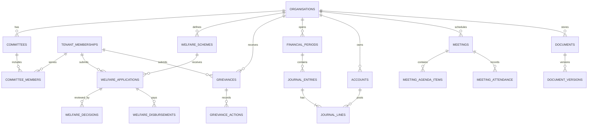

# UNI360 — Database Architecture

**Status:** Initial logical schema; not a production migration specification.  
**Database:** PostgreSQL

## 1. Design rules

1. Use UUID primary keys for externally exposed entities; internal bigint keys are acceptable only if consistently hidden behind opaque public IDs.
2. Every tenant-owned table carries `tenant_id`.
3. Add composite foreign keys where necessary to ensure a child row cannot reference a parent belonging to another tenant.
4. Add tenant-aware unique constraints, for example `(tenant_id, membership_number)`.
5. Store timestamps in UTC (`timestamptz`).
6. Use `numeric(p,s)` or integer minor units for money, never floating point.
7. Use explicit status columns and history tables for important lifecycle changes.
8. Keep private files in object storage; database stores metadata and opaque object keys.
9. Use soft deletion only where restoration is appropriate; legal/audit records may require immutable retention.
10. Never use a person's email or mobile number as a universal identity key without a verified, consent-aware identity policy.

## 2. Core entity groups

### Platform and identity

- `users`: authentication account.
- `people`: person profile, separate from login credentials.
- `organisations`: tenant registry and organisation profile.
- `organisation_domains`: verified host/domain mappings.
- `tenant_memberships`: person-to-organisation relationship.
- `roles`, `permissions`, `role_permissions`, `user_role_assignments`: scoped access control.
- `audit_events`: security and business audit events.

### Membership

- `membership_categories`
- `membership_applications`
- `memberships`
- `membership_status_history`
- `membership_number_sequences`
- `member_documents`
- `digital_id_cards`
- `id_verification_events`

### Governance and operations

- `committees`
- `office_bearer_terms`
- `committee_members`
- `meetings`
- `meeting_agenda_items`
- `meeting_attendance`
- `meeting_minutes`
- `resolutions`
- `notices`
- `notice_recipients`

### Welfare and grievances

- `welfare_schemes`
- `welfare_applications`
- `welfare_decisions`
- `welfare_disbursements`
- `grievances`
- `grievance_assignments`
- `grievance_actions`
- `grievance_attachments`

### Finance

- `financial_periods`
- `accounts`
- `journal_entries`
- `journal_lines`
- `payments`
- `receipts`
- `reconciliation_batches`

### Professional directory and documents

- `professional_categories`
- `professional_profiles`
- `professional_skills`
- `professional_profile_skills`
- `documents`
- `document_versions`
- `document_access_grants`

## 3. ER diagram — core foundation

```mermaid
erDiagram
    USERS ||--o| PEOPLE : "may link to"
    ORGANISATIONS ||--o{ TENANT_MEMBERSHIPS : contains
    PEOPLE ||--o{ TENANT_MEMBERSHIPS : joins
    USERS ||--o{ USER_ROLE_ASSIGNMENTS : receives
    ORGANISATIONS ||--o{ USER_ROLE_ASSIGNMENTS : scopes
    ROLES ||--o{ USER_ROLE_ASSIGNMENTS : assigned
    ROLES ||--o{ ROLE_PERMISSIONS : grants
    PERMISSIONS ||--o{ ROLE_PERMISSIONS : included
    ORGANISATIONS ||--o{ MEMBERSHIP_CATEGORIES : defines
    TENANT_MEMBERSHIPS ||--o{ MEMBERSHIP_APPLICATIONS : applies
    TENANT_MEMBERSHIPS ||--o{ MEMBERSHIPS : holds
    MEMBERSHIP_CATEGORIES ||--o{ MEMBERSHIPS : classifies
    MEMBERSHIPS ||--o{ MEMBERSHIP_STATUS_HISTORY : tracks
    MEMBERSHIPS ||--o{ DIGITAL_ID_CARDS : issues
    ORGANISATIONS ||--o{ AUDIT_EVENTS : records

    USERS {
      uuid id PK
      string email
      string password_hash
      timestamp email_verified_at
      timestamp created_at
    }
    PEOPLE {
      uuid id PK
      string display_name
      date date_of_birth
      string preferred_language
      timestamp created_at
    }
    ORGANISATIONS {
      uuid id PK
      string legal_name
      string slug
      string organisation_type
      string status
      string timezone
      timestamp created_at
    }
    TENANT_MEMBERSHIPS {
      uuid id PK
      uuid tenant_id FK
      uuid person_id FK
      string relationship_status
      timestamp created_at
    }
    MEMBERSHIP_CATEGORIES {
      uuid id PK
      uuid tenant_id FK
      string name
      jsonb rules
      boolean active
    }
    MEMBERSHIPS {
      uuid id PK
      uuid tenant_id FK
      uuid tenant_membership_id FK
      uuid category_id FK
      string membership_number
      string status
      date valid_from
      date valid_until
    }
    AUDIT_EVENTS {
      uuid id PK
      uuid tenant_id FK
      uuid actor_user_id FK
      string action
      string subject_type
      uuid subject_id
      jsonb metadata
      timestamp occurred_at
    }
```

## 4. ER diagram — domain expansion

## 5. Tenant constraints

For a tenant-owned entity, prefer:
- primary key `(id)` or UUID `id`;
- unique key `(tenant_id, business_key)`;
- foreign key `(tenant_id, parent_id)` referencing a matching unique `(tenant_id, id)` parent key.

This prevents accidental cross-tenant references at the database layer. Confirm PostgreSQL constraint design in migrations before enabling row-level security.

## 6. PostgreSQL Row-Level Security (RLS)

RLS is an additional defence, not a replacement for application authorisation. If used:
- set tenant context transaction-locally, e.g. `SET LOCAL app.tenant_id = '...'`;
- never use a persistent connection-level tenant setting that can leak between pooled requests;
- use a restricted application database role that does not bypass RLS;
- ensure migrations/maintenance use a separate privileged role;
- test pooled connections, jobs, CLI commands and transactions;
- fail closed when tenant context is absent.

Do not enable RLS casually before connection pooling and transaction boundaries are understood.

## 7. Financial ledger invariants

- Every posted journal entry balances: total debits = total credits.
- Posted entries are immutable; corrections use reversing entries.
- Each journal line belongs to the same tenant and financial period as its journal entry.
- Currency is explicit.
- Payment gateway callbacks are authenticated, idempotent and reconciled.
- Refunds and chargebacks are represented explicitly.
- Access to financial exports is separately permissioned and audited.

## 8. Indexing

Initial candidates:
- `(tenant_id, status)` on memberships and applications;
- `(tenant_id, membership_number)` unique;
- `(tenant_id, created_at)` on audit events;
- `(tenant_id, person_id)` on tenant memberships;
- `(tenant_id, valid_until)` for renewal reminders;
- GIN indexes only for justified JSONB/search use cases.

Use `EXPLAIN (ANALYZE, BUFFERS)` with representative data before adding complex indexes.

## 9. Migration sequencing

1. organisations and organisation domains;
2. users and people;
3. tenant memberships;
4. roles, permissions and assignments;
5. membership categories and applications;
6. memberships and status history;
7. documents and digital ID records;
8. audit events;
9. later business modules.

Every migration must be reversible where practical, safe for existing data, and tested against a clean database and an upgrade path.
